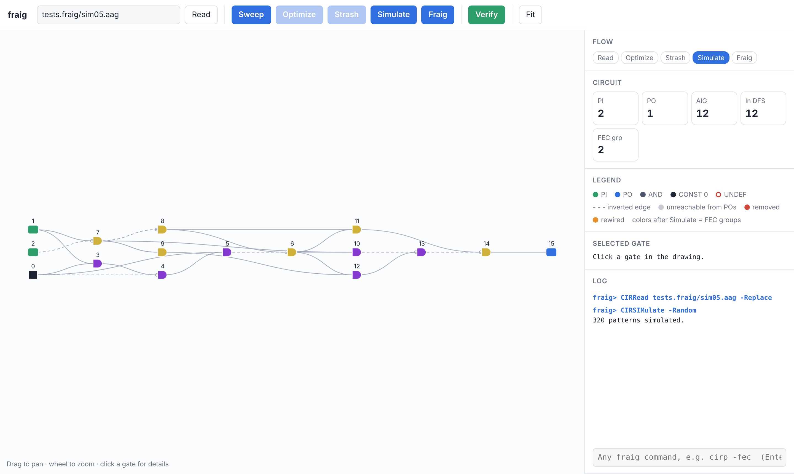
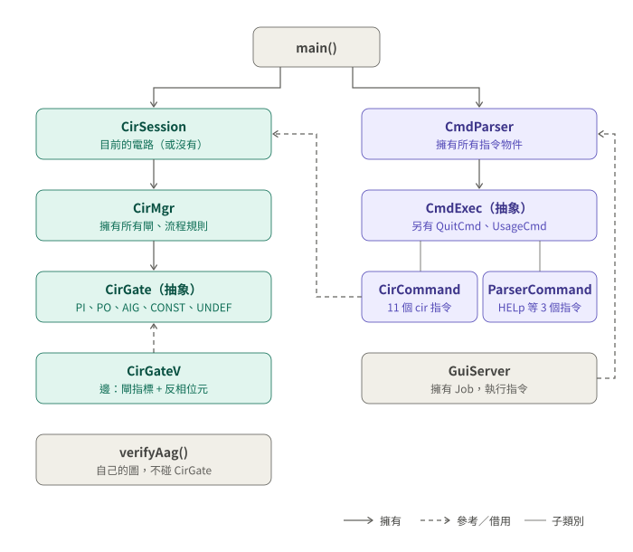

# fraig — AIG Circuit Reduction and Equivalence Checking

[](https://github.com/shihjimmy/Functionally-Reduced-And-Inverter-Graph/actions/workflows/ci.yml)

**fraig** reads a combinational circuit in AIGER format (`.aag`), makes it smaller **without changing
what it computes**, and **proves by itself** that the reduced circuit is equivalent to the original.
It has an interactive command line and a browser GUI that draws the circuit and animates every
reduction step.



The full design report (architecture, class relationships, data structures, algorithms, correctness
arguments, testing and performance) is in [`docs/report.pdf`](docs/report.pdf) (Traditional Chinese).

---

## 1. What it does

### And-Inverter Graphs

Any combinational circuit can be built from **two-input AND gates** and **inverters** only. An AIG
(And-Inverter Graph) is that representation: every node is an AND gate, a primary input (PI), a
primary output (PO) or constant 0, and every edge may carry an inversion mark. Because there is only
one kind of logic gate, AIGs are the standard data structure in modern logic synthesis and
verification tools. AIGER is the standard file format for them.

### FRAIG: Functionally Reduced AIG

Real circuits often contain gates that compute **exactly the same function** while looking
different. A FRAIG is an AIG in which no two nodes are functionally equivalent. fraig gets there in
five steps:

| Step | What it does | How it decides |
|---|---|---|
| **Sweep** | Remove gates that cannot reach any output | Reachability from the POs |
| **Optimize** | Constant propagation and trivial rules: `a&0=0`, `a&1=a`, `a&a=a`, `a&!a=0` | The two fanins only |
| **Strash** | Merge AND gates with identical fanins (structural hashing) | Hash table |
| **Simulate** | Group gates whose values have always been equal (or always opposite) so far into *FEC groups* (functionally equivalent candidates) | 64-bit parallel simulation |
| **Fraig** | Ask a SAT solver whether each candidate pair really is equivalent: merge if proven, otherwise use the counterexample to split the groups further | MiniSat |

Simulation can only say "maybe equal" (it tried finitely many inputs) or "definitely different";
SAT can say "definitely equal" but is expensive (NP-complete). Most of the engineering is about
letting cheap methods handle almost everything and keeping each SAT query small.

### Highlights

- **Complete FRAIG flow** with every command, report format and error message of the original
  specification; non-fraig output matches the reference implementation byte for byte.
- **Independent equivalence checker (`CIRVerify`)**: re-parses the original file into its own graph
  and proves the current circuit equivalent using structural hashing, random simulation and SAT
  sweeping; if they differ it reports a counterexample that has been re-simulated to confirm it.
  It deliberately shares no code with the reduction engine, so a bug there cannot hide itself.
- **Browser GUI**: levelized drawing of the circuit, one button per command, animations showing
  which gates were removed or rewired, FEC groups colored, long commands running in the background
  with a progress bar.
- **Fast**: the complete fraig flow is 2–7× faster than the course reference implementation, and
  every result is verified equivalent (Section 5).
- **Engineering**: C++17, explicit ownership (`unique_ptr` owns, raw pointers borrow), no global
  variables, CMake, 92 automated tests, GitHub Actions with g++, clang++ and
  AddressSanitizer + UBSan, zero compiler warnings.

---

## 2. Getting started

### Prebuilt binary

`bin/fraig` is a prebuilt Linux x86-64 binary (also works in WSL):

```bash
bin/fraig                           # interactive shell
bin/fraig -File script.dofile       # run a command script
bin/fraig -Gui                      # browser GUI at http://localhost:8080
```

### Build from source

Requires a C++17 compiler (g++ 9+ or clang++ 10+) and CMake 3.16+.

```bash
cmake -S . -B build -G Ninja        # drop "-G Ninja" if you don't have ninja
cmake --build build                 # -> build/fraig
ctest --test-dir build -j4          # all 92 tests
```

GoogleTest is fetched with git at configure time; add `-DFRAIG_UNIT_TESTS=OFF` to build offline.

| CMake option | Effect |
|---|---|
| `-DFRAIG_WERROR=ON` | Treat warnings as errors (used by CI) |
| `-DFRAIG_SANITIZE=ON` | Build with AddressSanitizer + UndefinedBehaviorSanitizer |
| `-DCMAKE_BUILD_TYPE=Debug` | Debug build (default is Release, `-O3`) |

### Example session

```
fraig> cirr tests.fraig/sim07.aag
fraig> cirsim -r
fraig> cirfraig
fraig> cirsw
fraig> ciropt
fraig> cirv
Verifying against "tests.fraig/sim07.aag"...
195 outputs: 10 identical by structure, 185 proven by SAT, 0 different.
Result: EQUIVALENT
```

### Commands

Commands are case-insensitive; the upper-case part is the shortest accepted abbreviation
(`cirsw` = `CIRSWeep`). *n* is the number of gates, *e* the number of edges.

| Command | Purpose | Time |
|---|---|---|
| `CIRRead <file.aag> [-Replace]` | Read a circuit | O(file size) |
| `CIRPrint [-Summary\|-Netlist\|-PI\|-PO\|-FLoating\|-FECpairs]` | Reports | O(n) |
| `CIRGate <id> [-FANIn\|-FANOut <level>]` | One gate: info, simulation value, FEC partners, fanin/fanout tree | O(output) |
| `CIRSWeep` | Remove gates unreachable from the POs | O(n) |
| `CIROPTimize` | Constant propagation and trivial simplification | O(n + e) |
| `CIRSTRash` | Structural hashing | O(n) expected |
| `CIRSIMulate -Random\|-File <patterns> [-Output <log>]` | 64-bit parallel simulation, builds FEC groups | O(n) per 64 patterns |
| `CIRFraig` | Prove and merge FEC groups with SAT | O(n) per round + SAT |
| `CIRWrite [<gateId>] [-Output <file>]` | Write AIGER (whole circuit or one gate's fanin cone) | O(n) |
| `CIRVerify [-File <file.aag>]` | Prove the current circuit equivalent to the original (or another file) | O(n) + SAT |
| `CIRJson` | Dump the circuit as JSON (used by the GUI) | O(n + e) |
| `HELp`, `HIStory`, `DOfile`, `USAGE`, `Quit` | General commands | |

**Flow rules** (from the specification): after simulation you must fraig before you can optimize or
strash again; strash cannot be run twice in a row; fraig requires a simulation first. Violations
print the specified error message and leave the circuit unchanged.

---

## 3. Architecture

```
     keyboard / dofile                         browser (GUI page)
            │                                        │ HTTP, 127.0.0.1 only
            │                               GuiServer (background worker thread)
            ▼                                        ▼ command string
  ┌──────────────────────────────────────────────────────────────┐
  │ cmd layer: CmdParser — read a line, history, completion, dispatch │
  └───────────────────────────────┬──────────────────────────────┘
                                  ▼ CmdExec::exec()
  ┌──────────────────────────────────────────────────────────────┐
  │ cir layer: circuit commands → CirMgr (netlist, all algorithms,  │
  │            flow rules);  CirVerify (independent checker)        │
  └───────────────┬────────────────────────────────┬─────────────┘
                  ▼                                ▼
             util (helpers)                 sat (MiniSat, third party)
```

Dependencies only point downward: the `cmd` layer knows nothing about circuits, so it could be
reused as is. **The GUI never calls circuit code directly** — every button sends a command string
through the same `CmdParser` as the keyboard, and circuit data comes back from the `CIRJson`
command. The CLI and the GUI therefore cannot behave differently.

### Classes and relationships



| Class | Responsibility | Ownership |
|---|---|---|
| `CirSession` | "The current circuit" (possibly none) | Owns a `unique_ptr<CirMgr>`; held by `main()` |
| `CirMgr` | One circuit: AIGER I/O, sweep / optimize / strash / simulation / fraig, reports, flow rules, invariant checks | Owns every gate |
| `CirGate` | Abstract gate base; subclasses `CirPiGate`, `CirPoGate`, `CirAigGate`, `CirConstGate`, `CirUndefGate` | Owned by `CirMgr` |
| `CirGateV` | An edge: gate pointer + inversion bit in 8 bytes | Borrows a gate |
| `CmdParser` | Command registry, line reading, dofiles, history | Owns all command objects; held by `main()` |
| `CmdExec` | Abstract command interface (`exec`, `usage`, `help`) | |
| `CirCommand` / `ParserCommand` | Command bases holding a `CirSession&` / `CmdParser&` | Borrow |
| `GuiServer` | HTTP server and background job | Owns the job record, borrows `CmdParser` |
| `AagFile`, `Graph`, `Simulator`, `SatSweeper` | The independent checker behind `CIRVerify` | Private to `cirVerify.cpp` |

**Ownership rule:** `std::unique_ptr` means *owns*, a raw pointer or reference means *borrows*.
Apart from MiniSat there is no hand-written `new`/`delete` and no global variable; everything an
object needs comes through its constructor or parameters.

---

## 4. Algorithms in brief

Full explanations, correctness arguments and complexity analysis are in
[`docs/report.pdf`](docs/report.pdf) Chapter 6 and [`docs/DESIGN.md`](docs/DESIGN.md).

- **Data structures.** Gates live in `vector<unique_ptr<CirGate>>` indexed by ID. A fanin edge is a
  `CirGateV` whose lowest pointer bit stores the inversion. Fanout lists are kept separately. The DFS
  list is a post-order walk from the POs, so every gate comes after its fanins.
- **Sweep / Optimize / Strash.** One pass in DFS order is enough because a gate's fanins are final
  by the time it is visited. Merging a gate moves all its fanouts to the new driver and *retires*
  the gate: ownership moves to a retired list and memory is released only when the command ends,
  so pointers held by an in-progress traversal stay valid.
- **Simulation.** Each gate's value is a 64-bit word, so one pass simulates 64 patterns (AND is
  bitwise `&`). FEC groups treat `v` and `~v` as the same group and record each member's phase;
  later batches split a group only by phase-corrected values. Random simulation stops when the
  groups have not changed for several consecutive batches.
- **Fraig.** In DFS order, the first member of each group is its representative and every other
  member is compared with it:
  - identical fanin edges → equivalent, merge without SAT;
  - otherwise ask SAT whether the two can differ. UNSAT → merge, and add the proven equivalence to
    the solver so later proofs get easier. SAT → keep the model as a counterexample; every 64
    counterexamples are simulated to split the groups.
  - The SAT model is built lazily: only the fanin cones of compared gates enter the solver.
  - The representative always comes earlier in DFS order, so merging can never create a cycle.
- **CIRVerify.** Both circuits are built into one structurally hashed graph. Each output pair is
  decided by structure, then random simulation, then *SAT sweeping*, which proves internal nodes
  equivalent from inputs to outputs so that every SAT query only covers a small region.
  Counterexamples are re-simulated before they are reported.

---

## 5. Performance

Measured against the course reference implementation in the same run (`scripts/bench.py`;
Linux, 2 CPUs, g++ 13, `-O3`):

| Circuit | Flow | Reference | fraig | Final AIGs (ref / fraig) |
|---|---|---:|---:|---|
| sim07 | random sim → fraig → sweep → optimize | 6.41 s | 1.49 s | 1175 / 1175 |
| sim12 | same | 2.12 s | 0.29 s | 0 / 0 |
| C7552 | same | 0.39 s | 0.09 s | 497 / 497 |
| sim13 (~85k gates) | same | 69.8 s | 21.8 s | 77313 / 77261 |
| sim13 | random simulation | 10.7 s | 1.9 s | – |
| sim13 | simulate a 76 MB pattern file | 1.17 s | 1.15 s | – |

fraig sometimes merges more than the reference (sim13: 77261 vs 77313 AND gates); every result is
proven equivalent to the original by `CIRVerify`. Memory usage and the full history are in
[`docs/benchmarks.md`](docs/benchmarks.md).

---

## 6. Testing

| Method | What it checks | Needs `ref/` |
|---|---|---|
| Golden outputs (59) | Command output compared byte for byte with verified results; fraig cases end with `CIRVerify` | no |
| Random circuits (200, in ctest) | Random circuits with edge cases (UNDEF, unused gates, constant inputs, duplicate fanins) must pass `CIRVerify` after the full flow | no |
| Unit tests (32, GoogleTest) | Internal invariants after every netlist-changing command, edge and gate types, flow rules | no |
| Differential testing | `tests/fuzz_diff.sh`: thousands of random circuits, 7 command flows, compared with the reference | yes |
| Parser fuzzing | `tests/fuzz_parser.sh`: corrupted files must produce the reference's error messages and never crash | yes |
| Checker self-test | `tests/verifier_selftest.sh`: deliberately broken circuits; `CIRVerify`'s verdicts and counterexamples must match the reference | yes |
| Sanitizers, valgrind | ASan + UBSan run all tests; valgrind reports no errors and no leaked memory | no |

GitHub Actions builds with g++ and clang++ (warnings as errors) and with sanitizers, and runs all 92
ctest tests on every push and pull request.

---

## 7. Repository layout

```
src/cir/        circuit: CirMgr, gates, commands, AIGER parser, sweep/optimize (cirOpt),
                simulation (cirSim), strash/fraig (cirFraig), CIRVerify (cirVerify),
                invariant checks (cirCheck), JSON
src/cmd/        command framework: CmdParser and general commands
src/main/       main(), GUI server and embedded web page
src/util/       helpers
src/sat/        MiniSat (third party, unmodified)
bin/            prebuilt fraig (Linux x86-64)
ref/            course reference binaries (Linux and macOS), used by the comparison tools
tests/          golden test cases, unit tests, random-circuit and fuzzing tools
tests.fraig/    benchmark circuits and simulation patterns (pattern.13 is gzipped)
scripts/        comparison with the reference, equivalence checking, benchmarking
docs/           design report (report.pdf, source in docs/report/), design notes,
                design decision records, benchmark log, course specification
review/         study notes (Traditional Chinese): C++, memory, system design, development workflow
```

`tests.fraig/pattern.13` (76 MB) is stored as `pattern.13.gz`; `scripts/bench.py` unpacks it on first
use, or run `gunzip -k tests.fraig/pattern.13.gz`.

---

## 8. Background and acknowledgements

This project started as the FRAIG final project of *Data Structures and Programming* (DSnP),
Department of Electrical Engineering, National Taiwan University, and was then extended with the
independent equivalence checker, the GUI, performance work, and a rewrite into a modern C++
engineering project. The course framework code, specification (`docs/FraigProject.pdf`), test
circuits and reference binaries are included with the course's permission.

## References

- A. Mishchenko, J.-H. R. Jiang, S. Chatterjee, R. K. Brayton, "FRAIGs: Functionally Reduced
  AND-INV Graphs," UC Berkeley. <https://people.eecs.berkeley.edu/~alanmi/research/fraigs/>
- N. Eén, N. Sörensson, "An Extensible SAT-solver," SAT 2003 (MiniSat). <http://minisat.se/>
- A. Biere, "The AIGER And-Inverter Graph (AIG) Format." <https://fmv.jku.at/aiger/>
