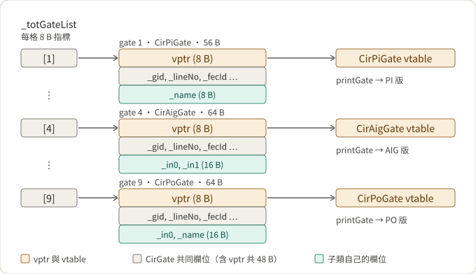
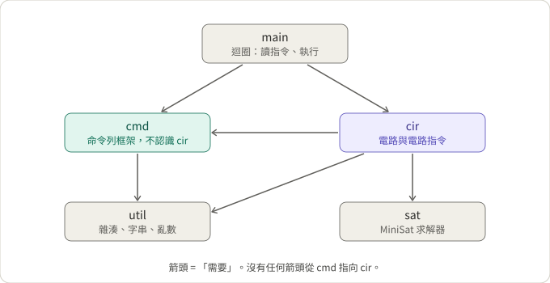

# 複習筆記：C++ class、記憶體、系統設計與現代 C++

這份筆記是給「做完專案之後，自己回頭複習」用的。每一章都對照 fraig 專案裡真實存在的程式碼，
裡面的數字（`sizeof`、位址、輸出）都是實際編譯、執行過的結果。

- 範例用 `g++ 13.3` 以 `-std=c++20 -Wall -Wextra` 編譯驗證（第 8 章的範例在 `examples/ch8/`，各自標明用的標準）。專案本身用 `-std=c++17` 編譯。
- 路徑都相對於專案根目錄（`fraig/`）。
- 標示「建議」的段落是我的設計意見，不是原專案的寫法。
- 每章最後的「自我檢查」建議先自己回答，再展開看答案。

## 目錄

1. [class 基礎](#1-class-基礎)
2. [記憶體](#2-記憶體)
3. [繼承與多型](#3-繼承與多型)
4. [其他必備語法](#4-其他必備語法)
5. [從原始碼到執行檔](#5-從原始碼到執行檔)
6. [fraig 的系統設計](#6-fraig-的系統設計)
7. [現代 C++](#7-現代-c)
8. [未定義行為、所有權、錯誤處理與效能基礎](#8-未定義行為所有權錯誤處理與效能基礎)
9. [問答整理](#9-問答整理)
10. [用 gdb 追程式](#10-用-gdb-追程式)
11. [自我檢查](#11-自我檢查)
12. [現代軟體開發流程](#12-現代軟體開發流程)

---

## 1. class 基礎

### 1.1 為什麼需要 class

class 把「資料」和「操作這些資料的函式」包成一個單位，並且能控制外界能碰哪些部分。
專案裡每個電路閘就是一個 `CirGate` 物件（`src/cir/cirGate.h`）。

### 1.2 成員與存取權限

```cpp
class Gate {
public:                                   // 誰都能用
   Gate(unsigned g, unsigned l) : _gid(g), _lineNo(l) { ++_count; }
   unsigned getGid() const { return _gid; }
   static unsigned count() { return _count; }
private:                                  // 只有 Gate 自己的成員函式能碰
   unsigned _gid, _lineNo;
   static unsigned _count;
};
unsigned Gate::_count = 0;                // static 資料成員要在 .cpp 裡定義一次
```

| 權限 | 誰能存取 |
|---|---|
| `public` | 任何人 |
| `protected` | 自己與子類別 |
| `private` | 只有自己（與 friend） |

習慣：資料放 `private` 或 `protected`，只開放必要的函式。這樣出問題時，
能改動這份資料的地方有限，好查。

> struct 與 class 唯一的語法差異是預設權限：struct 預設 `public`，class 預設 `private`。

### 1.3 建構子與初始化列表

```cpp
CirGate(unsigned g, unsigned l) : _gid(g), _lineNo(l), _pValue(0) {}
//                              ^^^^^^^^ 初始化列表
```

冒號後面是**初始化列表**：成員在進入函式本體之前就被初始化。比起在本體裡 `_gid = g;`，
它有兩個差別：

- `const` 成員與參考成員**只能**在初始化列表初始化。
- 初始化的順序是「成員在 class 裡宣告的順序」，不是你在列表裡寫的順序。

### 1.4 const 成員函式

```cpp
unsigned getGid() const { return _gid; }   // 承諾不改變物件
```

`const` 物件（或 `const CirGate&`）只能呼叫 `const` 成員函式。能標 `const` 的函式都應該標，
這是在告訴讀者與編譯器「這個函式只讀」。

### 1.5 static 成員

`static` 資料成員屬於整個 class，不是某個物件，所有物件共用一份。
專案的例子是 `CirGate::_globalRef_s`：走訪電路時用來標記「這個閘這輪走過了」。
不用每次清空 visited 陣列，把全域計數加一就等於全部重設（`cirGate.h`、`cirGate.cpp`）。

我實測：建立兩個 `Gate` 後，`Gate::count()` 回傳 2。

### 1.6 this

在成員函式裡，`this` 是指向「目前這個物件」的指標。`_gid` 其實是 `this->_gid` 的簡寫。

### 1.7 標頭檔（.h）與實作檔（.cpp）

- `.h` 放**宣告**：class 長什麼樣、有哪些函式。
- `.cpp` 放**定義**：函式的內容，寫成 `CirPiGate::printGate() const { ... }`。
- 別的檔案 `#include` 標頭檔就能使用，不需要看實作。
- 標頭檔要有 include guard，避免被重複包含：

```cpp
#ifndef CIR_GATE_H
#define CIR_GATE_H
// ...
#endif
```

### 1.8 複製與所有權（Rule of 3 / 5 / 0）

如果 class 自己管理資源（像階段 6 之前的 `CirPiGate` 用 `new[]` 配置 `_name`），預設的「逐欄位複製」只會複製指標，
兩個物件會指向同一塊記憶體，之後各自 `delete[]` 就會重複釋放。
（階段 6 已把 `_name` 改成 `std::string`，`CirPiGate` 因此不再需要解構子，見 8.2.1。）

- **Rule of 3**：你需要自訂解構子，通常也要自訂「複製建構子」與「複製賦值」。
- **Rule of 5**：加上「搬移建構子」與「搬移賦值」（見第 7 章）。
- **Rule of 0**：最好的做法是不直接管理資源，改用 `std::string`、`std::vector`、`std::unique_ptr`，
  就什麼都不用自己寫。

不想讓物件被複製時，明確禁止：`Gate(const Gate&) = delete;`。

### 自我檢查（第 1 章）

<details><summary>1. 為什麼 <code>const</code> 成員只能用初始化列表初始化？</summary>
進入函式本體時，所有成員已經初始化完畢；<code>const</code> 成員之後不能再賦值，所以必須在初始化列表就給值。
</details>

<details><summary>2. <code>static</code> 資料成員為什麼要在 .cpp 另外定義一行？</summary>
class 內只是宣告，沒有分配空間。它屬於整個程式只有一份，必須在某個 .cpp 檔裡定義一次，才有實際的儲存位置。
</details>

---

## 2. 記憶體

### 2.1 stack 與 heap

| | stack（堆疊） | heap（堆積） |
|---|---|---|
| 怎麼來 | 區域變數，進入函式自動配置 | `new` 配置 |
| 怎麼釋放 | 離開範圍自動釋放 | 你呼叫 `delete`（或交給智慧指標） |
| 大小與速度 | 小、很快 | 大、較慢 |

```cpp
int x = 5;               // stack
int* p = new int(5);     // heap；p 本身在 stack，指向 heap 上的 int
delete p;
```

專案裡每個閘都用 `new` 配置在 heap（`new CirPiGate(...)`），由 `CirMgr::deleteCircuit()` 手動 `delete`。

### 2.2 指標與參考

- **指標** `T*`：存「某個 T 的位址」，可以是空的（`nullptr`），可以改指向別處。用 `->` 或 `*` 存取。
- **參考** `T&`：某個物件的別名，必須在建立時綁定，之後不能改綁，沒有「空參考」。用 `.` 存取。
- 傳大型物件時用 `const T&` 避免複製。

### 2.3 指標有多大

指標存的是記憶體位址，寬度由 CPU 架構與編譯器的目標平台（ABI）決定，**跟指向什麼型別無關**。

- 64 位元平台：位址 64 bit，指標 8 B。
- 32 位元平台：指標 4 B（所以最多定址 4 GB）。

我在這台電腦實測：`char*`、`int*`、`CirGate*` 都是 8 B。

### 2.4 sizeof 與對齊（padding）

編譯器會把每個成員放在「自己大小的倍數」的位址上，中間補空白；整個結構的大小也會補到最大成員的倍數。

```cpp
struct A { char c; int i; };                 // sizeof = 8   (1 + 補 3 + 4)
struct B { char c1; double d; char c2; };    // sizeof = 24  (1 + 補 7 + 8 + 1 + 補 7)
struct C { double d; char c1; char c2; };    // sizeof = 16  (8 + 1 + 1 + 補 6)
```

小技巧：成員**從大排到小**，可以減少 padding。

### 2.5 new / delete 與 new[] / delete[]

- `new T` 配 `delete`；`new T[n]` 配 `delete[]`。配錯是未定義行為。
- `delete[]` 只釋放**陣列本身**：

```cpp
Gate** list = new Gate*[2];   // 陣列裡存的是指標
delete[] list;                // 只釋放那個陣列；指標指向的物件不會被釋放
```

階段 6 之前，專案的 `_totGateList` 就是這種陣列（`CirGate**`），所以 `deleteCircuit()` 要先逐一 `delete` 每個閘，
再 `delete[]` 陣列本身。階段 6 之後它變成 `vector<unique_ptr<CirGate>> _gates`，這兩步都由型別自動完成，
`deleteCircuit()` 整個函式被刪掉了（見 8.2.1）。

### 2.6 專案裡閘物件在記憶體中的樣子



實測 `sizeof`：

| 類別 | 大小 |
|---|---|
| `CirPiGate` | 56 B |
| `CirPoGate` | 64 B |
| `CirAigGate` | 64 B |
| `CirConstGate` | 56 B |
| `CirUndefGate` | 48 B |
| `CirGateV` | 8 B |

怎麼來的（以 `CirAigGate` 為例）：

```
偏移  0   vptr               8 B
偏移  8   _gid               4 B
偏移 12   _lineNo            4 B
偏移 16   _pValue            8 B
偏移 24   _fecId             4 B   (+4 B padding)
偏移 32   _eqGate            8 B
偏移 40   _ref               4 B   (+4 B padding)   ← 到這裡 48 B 是 CirGate 的部分
偏移 48   _in0               8 B
偏移 56   _in1               8 B                    ← 共 64 B
```

重點：

- 不同閘大小不同，不能直接放進同一個陣列，但**指標一樣大**，所以陣列存指標。
- 物件的開頭是 vptr（第 3 章），接著是 `CirGate` 的共同欄位，最後才是子類自己的欄位。
  所以 `CirGate*` 指到 `CirAigGate` 開頭，前 48 B 看起來就是一個完整的 `CirGate`。
- 我用 gdb 在跑 `sim01.aag` 時印出 gate 4、5、6 的位址，分別是 `0x…08a0`、`0x…08f0`、`0x…0940`，
  間隔 `0x50`（80 B）。物件 64 B，多出來的是 malloc 的管理資訊與對齊。
- **指標標記（pointer tagging）**：gate 6 的 `_in0` 值是 `0x5555555b08a1`，而 gate 4 的位址是 `0x5555555b08a0`，
  差在最低一個 bit。這個 bit 是「這條邊有反相」的旗標（gate 6 在檔案中是 `!4`，`isInv()` 印出 `true`）。
  能這樣做是因為 malloc 給的位址一定是對齊的，最低幾個 bit 永遠是 0，可以借來存旗標。
  代價是可讀性；現代寫法會把它包成小型別，並用 `std::uintptr_t` 轉換位址。

### 自我檢查（第 2 章）

<details><summary>1. <code>int* p = new int[10];</code> 要怎麼釋放？只寫 <code>delete p;</code> 會怎樣？</summary>
要用 <code>delete[] p;</code>。用 <code>delete p;</code> 是未定義行為。
</details>

<details><summary>2. 為什麼 <code>_totGateList</code>（現在的 <code>_gates</code>）存指標，而不是直接存閘物件？</summary>
閘有五種，大小不同（48～64 B），陣列元素必須一樣大。指標大小固定為 8 B，而且指標可以指向任何一種閘。
</details>

<details><summary>3. <code>struct { char a; double b; char c; }</code> 為什麼是 24 B？怎麼省空間？</summary>
a 後補 7 B 才能讓 double 對齊 8，c 後再補 7 B 讓整體是 8 的倍數。把 <code>double</code> 放前面，變成 16 B。
</details>

---

## 3. 繼承與多型

### 3.1 繼承與 is-a

```cpp
class CirPiGate  : public CirGate { ... };   // PI「是一種」閘
class CirAigGate : public CirGate { ... };
```

子類別繼承父類別的成員，並能新增自己的。`public` 繼承表示「is-a」關係：
任何需要 `CirGate` 的地方，都能放一個 `CirPiGate`。

### 3.2 子類指標可以自動當父類指標（upcast）

```cpp
CirGate* g = new CirPiGate(1, 2);   // 自動轉換，不用寫轉型
```

在單一繼承下，物件開頭就是父類的部分，所以這個轉換**不需要改變位址**，沒有執行時成本。

### 3.3 virtual 與 vtable

```cpp
virtual void printGate() const = 0;      // 在 CirGate 裡
```

- 有 `virtual` 函式的物件，開頭藏著一個指標 **vptr**，指向該類別的 **vtable**（虛擬函式表）。
  vtable 每個類別只有一份，不是每個物件一份。
- 呼叫 `g->printGate()` 時，程式讀物件開頭的 vptr，到 vtable 找到函式位址，再跳過去。
  所以呼叫哪個版本是**執行時**依「物件真正的類別」決定的，這就是多型。
- 沒有 `virtual` 的話，永遠只呼叫指標型別（`CirGate`）自己的版本。

用 gdb 在 `cirp -n` 時看到的物件內容：`_vptr.CirGate = ... <vtable for CirPiGate+16>`，
也就是這個 `CirGate*` 實際上是 `CirPiGate`。

> vptr 放在物件開頭、每個類別一份 vtable，是 GCC / Clang 的實作方式，C++ 標準本身沒有規定。

這個專案裡 `cirp -n` 印出 `PI  1 (a)`、`AIG 4 1 2`、`PO  9 !6` 格式各不相同，
就是因為各子類別各自實作了 `printGate`，迴圈卻只用 `_dfsList[i]->printGate()` 一行。

### 3.4 純虛函式與抽象類別

`= 0` 的虛擬函式叫**純虛函式**：父類別不給實作，每個子類別都必須實作。
含有純虛函式的類別是**抽象類別**，不能直接建立物件，只能當介面或基底。
`CirGate` 與 `CmdExec`（指令介面）都是抽象類別。

### 3.4.1 override 與 final（C++11）

```cpp
struct PiGate final : Gate {                          // final：不能再被繼承
   string name() const override { return "PI"; }      // override：確認真的覆寫了父類的虛擬函式
};
```

`override` 讓編譯器檢查：如果你拼錯函式名或參數不一致，會直接報錯，而不是默默變成一個新函式。
專案的子類別完全沒有標 `override`（我用 grep 查過，0 處），這是建議加上的地方。

### 3.5 建構與解構的順序

我寫了小程式，輸出如下：

```
new CirPiGate:               delete g:
  CirGate()                    ~CirPiGate()  frees _name
  CirPiGate()                  ~CirGate()
```

- **建構**：先基底、再子類（子類可能會用到基底的成員）。
- **解構**：順序相反，先子類、再基底。
- 子類解構子執行完後，編譯器**自動**接著呼叫基底解構子，你不用寫，也關不掉。
- 記憶體只在兩個解構子都跑完後釋放一次。

### 3.6 virtual 解構子

```cpp
CirGate* g = new CirPiGate(1, 2);
delete g;
```

`delete g` 的意思是「先呼叫解構子，再釋放記憶體」。

- 如果 `~CirGate()` **不是** `virtual`：編譯器只看指標型別，只會呼叫 `~CirGate()`，
  `~CirPiGate()` 根本不會執行，`_name` 沒人釋放；而且這在標準裡是**未定義行為**。
- 如果是 `virtual`：`delete` 經由 vtable 找到真正的類別，先跑 `~CirPiGate()`，再跑 `~CirGate()`。

兩個機制要分開記：`virtual` 決定「**從哪個解構子開始**」，之後的「接著跑基底」是自動的。

規則：**只要 class 會被當基底、並透過基底指標 `delete`，解構子就要是 `virtual`。**

### 3.7 物件切割（slicing）

```cpp
Derived d;
Base b = d;        // 以「值」複製：只拷貝 Base 那一部分，Derived 多出來的欄位被切掉
Base* bp = &d;     // 以「指標」指著：保留完整物件
```

我實測：`sizeof(Base) = 16`、`sizeof(Derived) = 24`；`b.hi()` 印 `Base::hi`，
`bp->hi()` 印 `Derived::hi`。所以要裝不同子類的容器，放**指標**（或智慧指標），不放物件本身。

### 3.8 轉型與不變量

子類 → 父類，編譯器自動做。反過來（`CirGate*` → `CirPiGate*`）編譯器不知道指到的是不是 PI，需要你明確轉型。

```cpp
_piList[i] = static_cast<CirPiGate*>(gate);     // src/cir/cirMgr.cpp 的 parseInput
```

| 轉型 | 何時檢查 | 說明 |
|---|---|---|
| `static_cast<T*>(p)` | 編譯時，只檢查型別有繼承關係 | 「我保證它是 T，你相信我」；保證錯了**不會報錯** |
| `dynamic_cast<T*>(p)` | 執行時，查 vptr | 不是 T 就回傳 `nullptr`；只能用在有 virtual 的類別；有額外成本 |

保證錯了會怎樣：PI 的 `_name` 在物件偏移 48，AIG 在同一個位置存的是 `_in0`。
把 AIG 當 PI 用，程式會把 `_in0` 的位元當成字串位址去讀，不是亂碼就是當掉。

實測 `dynamic_cast`（對一個實際是 AIG 的閘）：

```
dynamic_cast<CirPiGate*>(a)  = 0          (空指標：它不是 PI)
dynamic_cast<CirAigGate*>(a) = non-null   (它是 AIG)
```

**不變量（invariant）** 是程式保證永遠成立的條件。`parseInput` 的轉型是安全的，
因為 `checkGate` 在 `type == PI` 時一定建出 `CirPiGate`。
更好的做法是盡量不需要轉型：專案裡用 `isPi()`、`isAig()` 這種虛擬函式「問」物件，而不是轉型。

### 3.9 胖介面的取捨

`CirGate` 有 `getIn0()`、`getIn1()`，PI 也能呼叫（回傳 0）。好處是呼叫端不用轉型；
壞處是呼叫端可能對 PI 去取輸入而不自知。現代設計會盡量讓不合理的操作編譯不過。
（階段 7 已經改掉，見 3.10。）

### 3.10 階段 7 實作：讓型別只代表一種東西

完整設計在 `docs/TYPES.md`。這一節挑出專案裡真實的改動，每一個都對應一個 C++ 觀念。

**1. `explicit` 建構子：整數不是邊**

```cpp
// 改之前
CirGateV(size_t v = 0): _gateV(v) {}        // 任何整數都能變成「邊」
mergeGate(g, CirGateV(size_t(r) + (inv ? 1 : 0)));   // 手算位元
// 改之後
explicit CirGateV(CirGate* g, bool inv = false);
mergeGate(g, CirGateV(r, inv));             // 說的就是意思
```

沒有 `explicit` 的單參數建構子是一個**隱含轉換**：`CirGateV e = 5;` 會編譯通過。
加上 `explicit` 後，只能寫 `CirGateV(g)`，型別錯了就是編譯錯誤。
單元測試用 `static_assert(!std::is_convertible<size_t, CirGateV>::value)` 把這件事固定下來：
以後如果有人把隱含轉換加回去，測試檔直接編譯失敗。

同理，`explicit operator bool()` 讓 `if (e)` 可以寫，但 `bool b = e;` 或 `e + 1` 不行（C++11 起）。

**2. 一個型別在不同時間代表不同東西：最隱蔽的 bug 來源**

改之前，parser 先把 **literal 編號**（例如 `9` 代表 `!4`）存進 `CirGateV`，
等所有閘都建好，`genConnections()` 再把它換成真正的指標。在這兩步之間，對這條「邊」呼叫 `gate()`
會把整數 9 當成位址，得到垃圾指標，而且型別系統完全不知道。

改之後，literal 存在另一個結構（`PendingFanins`），`CirGateV` 從建立那一刻起就是真的邊。
附帶的好處：換成指標的工作原本要透過**全域** `cirMgr`，現在由 `CirMgr::connectFanins()` 自己做，
所以任何一個 `CirMgr` 物件都能正確讀檔。單元測試 `TwoManagersAreIndependent` 同時讀兩個電路來證明這點。

**3. 同一件事只存一份**

邊上原本有一個「浮接」位元，意思是「這條邊的來源是 UNDEF 閘」。但「是不是 UNDEF」本來就是閘的屬性，
存兩份就要每次修改都記得同步（`replaceFanin` 裡真的有 `if (n->isUndef()) setFloat()` 這種補丁）。
改成 `isFloat()` 直接問 `gate()->isUndef()`，就不可能不一致。

**4. `enum class`**

```cpp
enum GateType { UNDEF_GATE, PI_GATE, ... };                         // 改之前：名字在全域，可以當整數用
enum class GateType : unsigned char { Undef, Pi, Po, Aig, Const };  // 改之後
```

- 名字在 `GateType::` 底下，不會和別的 `Pi` 撞名。
- 不會隱含轉成整數：`cout << type` 編譯不過，要寫 `gateTypeName(type)`。實作時編譯器真的抓到這一行。
- `: unsigned char` 指定底層型別，只占 1 byte。

**5. 型別標籤取代一堆虛擬函式**

改之前，`isPi()`、`isPo()`、`isAig()`、`isConst()`、`isUndef()`、`getType()`、`getTypeStr()` 七個虛擬函式，
每個子類別各自覆寫。型別其實在建構時就固定了，所以改成基底存一個 `const GateType _type`，
這些函式變成一般的比較（不是虛擬呼叫），子類別少寫二十幾行。

**物件大小的教訓**：一開始我把 `_type` 放在 `_lineNo` 後面，`CirAigGate` 從 64 bytes 變成 72 bytes。
原因是對齊（2.4 節）：後面的 `_pValue` 是 8 bytes，必須從 8 的倍數開始，所以 1 byte 的 `_type` 後面被補了 7 bytes。
把它移到 `_fecId`（4 bytes）後面，那裡原本就有 4 bytes 的空隙，大小就回到 64。
現在單元測試用 `static_assert(sizeof(CirAigGate) == 64)` 守住它。

**6. 胖介面 → 通用介面 + 安全的向下轉型**

```cpp
// 處理「任何閘」：每種閘都能正確回答
for (unsigned i = 0; i < g->numFanins(); ++i) use(g->fanin(i));   // PI 回答 0 個
// 只處理 AIG：先問，再用 AIG 自己的介面
if (const CirAigGate* aig = g->asAig()) use(aig->in0(), aig->in1());
```

`asAig()` 是「有檢查的向下轉型」：型別標籤是 AIG 才 `static_cast`，否則回傳 `nullptr`。
它不用 `dynamic_cast`，因為型別標籤已經知道答案，不需要執行時查 RTTI。
對 PI 呼叫 `in0()` 現在是**編譯錯誤**（`CirGate` 沒有這個函式），而不是安靜地拿到空邊。

改完介面後，編譯器列出 36 個錯誤，正好是所有用到舊介面的地方，一個一個改掉就完成了。
**改型別，讓編譯器幫你找出所有要改的地方**，比用搜尋可靠得多。

**7. 單元測試看得到黃金輸出看不到的東西**

`CirMgr::checkInvariants()` 檢查 netlist 的內部關係（fanin 和 fanout 一致、DFS 順序、計數…），
單元測試在每個改電路的指令之後呼叫它。我故意在 `retireGate` 放一個 bug（少從一個 fanin 的 fanout 清單移除）：

| 測試 | 結果 |
|---|---|
| 56 個黃金輸出測試 | **全部通過**（印出來的東西沒變） |
| 單元測試 | 失敗：`CONST(0) has a fanout that is not in the netlist`, after sweep |

這個 bug 會在之後某次改電路時讀到已釋放的記憶體，但當下的輸出完全正常。
黃金輸出測試回答「看得到的行為對不對」，單元測試回答「內部狀態對不對」，兩種都需要。

### 自我檢查（第 3 章）

<details><summary>1. 為什麼 <code>vector&lt;CirGate*&gt;</code> 能放 PI、AIG、PO 各種閘？</summary>
子類指標可以自動轉成父類指標；陣列存的是指標（大小固定）；呼叫虛擬函式時靠 vptr 在執行時找到真正的版本。
</details>

<details><summary>2. 如果把 <code>virtual ~CirGate()</code> 的 <code>virtual</code> 拿掉會發生什麼？</summary>
透過 <code>CirGate*</code> 做 <code>delete</code> 時，只呼叫 <code>~CirGate()</code>，子類的解構子不會執行（例如 PI 的 <code>_name</code> 沒釋放），而且是未定義行為。
</details>

<details><summary>3. 建構與解構的順序為什麼相反？</summary>
子類部分可能依賴基底部分，所以建構時基底先好，解構時子類先清，這樣子類解構時基底還沒被破壞。
</details>

<details><summary>4. <code>static_cast</code> 與 <code>dynamic_cast</code> 差在哪？</summary>
前者只在編譯時檢查型別關係，保證錯了也不報錯；後者在執行時查型別，不符合回傳 nullptr，但有成本。
</details>

<details><summary>5. 為什麼 <code>CirGateV</code> 的建構子要加 <code>explicit</code>？不加會怎樣？</summary>
不加的話，單參數建構子是隱含轉換：<code>CirGateV e = 5;</code>、把整數傳給要 <code>CirGateV</code> 的函式，都會編譯通過，得到一條指向位址 5 的邊。加了之後只能明確寫 <code>CirGateV(g)</code>。
</details>

<details><summary>6. <code>asAig()</code> 為什麼可以安全地用 <code>static_cast</code>，不需要 <code>dynamic_cast</code>？</summary>
它先檢查型別標籤 <code>_type == GateType::Aig</code>，標籤在建構時就固定、不會錯，所以只有真的是 AIG 時才轉型，其他情況回傳 nullptr。<code>dynamic_cast</code> 是在執行時查 RTTI 得到同樣的答案，多了成本。
</details>

<details><summary>7. 把 1 byte 的 <code>_type</code> 放在 <code>_lineNo</code> 後面，為什麼 <code>CirAigGate</code> 會多 8 bytes？</summary>
後面的 <code>_pValue</code> 是 8 bytes，要從 8 的倍數位址開始。<code>_lineNo</code> 結束在偏移 16，放入 <code>_type</code> 後到 17，<code>_pValue</code> 只好跳到 24，中間補 7 bytes，後面的欄位全部往後推 8。放在 <code>_fecId</code> 後面就落在原本的 4 bytes 空隙裡。
</details>

<details><summary>8. 為什麼故意放的 bug 讓黃金輸出測試全過，單元測試卻抓到？</summary>
那個 bug 只讓某個 fanout 清單多留了一個已移除的閘，當下印出來的電路完全正確，黃金輸出看不出來。單元測試直接檢查 fanin 與 fanout 是否一致，所以立刻發現。
</details>

---

## 4. 其他必備語法

### 4.1 運算子多載

```cpp
struct V2 { int x, y; };
ostream& operator<<(ostream& os, const V2& v) { return os << "(" << v.x << "," << v.y << ")"; }
// cout << V2{3, 4};   →  (3,4)
```

專案裡 `CirGateV` 就多載了 `operator<<`，印出 `!4`、`*5` 這種帶反相或 floating 標記的輸出（`cirGate.cpp`）。
`friend` 讓非成員函式也能存取 class 的 private 成員，`operator<<` 常這樣用。

### 4.2 template

```cpp
template<class T> void clearList(T& l) { T tmp; l.swap(tmp); }   // src/util/util.h
```

`T` 是型別參數，同一份程式碼能用在 `vector<CirGate*>`、`vector<unsigned>` 等。
這個函式用到的「swap 技巧」：`vector::clear()` 只清內容，**容量（capacity）仍保留**；
和一個空的暫時 vector 交換，才會真正歸還記憶體。我實測：`clear()` 後容量仍 ≥ 1000，swap 後是 0。

### 4.3 STL 容器

| 容器 | 用途 | 專案中的例子 |
|---|---|---|
| `vector<T>` | 動態陣列，連續記憶體 | `GateList`、`IdList` |
| `map<K,V>` | 有序鍵值表（紅黑樹，O(log n)） | `CmdParser::_cmdMap` |
| `unordered_map<K,V>` | 雜湊表（平均 O(1)），C++11 | strash 時可用 |
| `stack<T>`、`pair<A,B>` | 堆疊、成對資料 | `_dofileStack`、`CmdRegPair` |

### 4.4 巨集

```cpp
#define CmdClass(T)  class T: public CmdExec { public: ... }   // src/cmd/cmdParser.h
CmdClass(CirReadCmd);       // 展開成一整個 class 宣告
```

巨集是**文字替換**，發生在編譯之前，沒有型別檢查，除錯時看到的是展開後的程式碼。
它省下重複的樣板，但現代 C++ 傾向用 template 或函式取代（見第 7 章）。

### 4.5 typedef 與 enum

```cpp
typedef vector<CirGate*> GateList;     // 舊寫法；現代寫法：using GateList = vector<CirGate*>;
enum GateType { UNDEF_GATE, PI_GATE, ... };     // 舊式 enum：名稱會洩漏到外層、可隱含轉成 int
```

### 4.6 位元運算

指標標記用到 `&`、`|`、`^`、位移：

```cpp
bool isInv() const { return (_gateV & AIG_NEG_FANIN); }   // 取最低 bit
```

64 位元平行模擬（`sim`）也是用位元運算：一個 `size_t` 同時代表 64 組 pattern，
一個 `&` 就一次算完 64 組 AND。

### 4.7 全域變數、static 與 extern

- 全域變數（階段 8 之前的 `cirMgr`、`cmdMgr`）：整個程式共用。方便，但誰都能改，測試和除錯都更困難。
- 檔案內的 `static` 變數：只有該 .cpp 看得到（例如階段 8 之前 `cirCmd.cpp` 的 `curCmd`）。
- `extern`：宣告「這個變數在別的檔案定義」，連結時才接上（例如 `extern CirMgr* cirMgr;`）。

（階段 8 已經把這些全域狀態全部拿掉，見 4.8。）

### 4.8 階段 8 實作：去除全域狀態

完整設計在 `docs/GLOBALS.md`。

**1. 全域變數真正的問題：簽名說謊**

```cpp
void CirGate::reportGate() const;                         // 改之前：看起來什麼都不需要
// 實作裡：const IdList& fecs = cirMgr->getFECGrps(...);  ← 偷偷讀了全域的電路
void CirGate::reportGate(const CirMgr& circuit) const;    // 改之後：簽名說出它需要電路
```

全域變數讓函式的依賴藏在實作裡。單元測試同時建兩個 `CirMgr` 時，改之前的 `reportGate()`
會去讀「全域指標指向的那個」，而不是閘所屬的電路。

**2. 依賴注入（dependency injection）：建構時給它需要的東西**

```cpp
// main.cpp：程式的狀態都在這裡
CirSession session;          // 目前的電路
CmdParser  parser("fraig> ");
initCommonCmd(parser);              // HELP / DOfile 拿到 parser 的參考
initCirCmd(parser, session);        // 每個 cir 指令拿到 session 的參考
```

指令不再自己去找全域變數，而是在建構時拿到它要用的物件：`explicit CirReadCmd(CirSession& s)`。
這叫**依賴注入**。好處是依賴一目了然，而且測試時可以給它別的物件。

為什麼用參考（`&`）不用指標？參考表示「一定有、不會是空的」，而且不能改指向別的物件。
前提是被參考的物件活得比較久：`session` 和 `parser` 都在 `main` 裡，活到程式結束。

**宣告順序有意義**：區域變數依宣告的**相反**順序銷毀。`session` 宣告在 `parser` 前面，所以 `parser`
（以及它擁有的指令）先銷毀，`session` 後銷毀：指令持有的參考不會在指令還活著的時候失效。

**3. 規則放在對的地方：流程規則屬於電路**

「模擬之後不能 optimize」原本寫在指令層的 `static curCmd` 裡，每個指令自己檢查、自己更新。
但這其實是**電路的狀態**：這個電路做過什麼，決定它接下來能做什麼。所以移進 `CirMgr`：

```cpp
const char* CirMgr::whyNot(CirStep next) const;   // nullptr = 可以；否則是錯誤訊息
void CirMgr::optimize() {
   assert(!whyNot(CirStep::Optimize));            // 領域層自己保證規則
   _lastStep = CirStep::Optimize;
   ...
}
```

換電路就是建新的 `CirMgr`，狀態自然重置，不需要記得 `curCmd = CIRINIT`。

**搬移時抓到的 bug**：`fraig()` 內部會呼叫 `strash()`。規則搬進 `strash()` 之後，fraig 跑完狀態變成
「剛做完 strash」，下一次 `cirstrash` 就會錯誤地回報「已經 strash 過」。改之前不會出事，因為狀態只在指令層更新。
解法是把「流程步驟」和「實際工作」分開：公開的 `strash()` 檢查並記錄步驟，私有的 `strashNetlist()` 做事，
`fraig()` 呼叫後者。這個 bug 由新的單元測試 `FlowRules.FraigDoesNotCountAsStrash` 守住
（我暫時把它改回去，測試確實失敗）。

**教訓**：當一個函式同時是「使用者看得到的操作」和「別的函式的內部步驟」，把規則加進去之前要先問：
內部呼叫的時候，規則也該生效嗎？

**4. 檔案層級的 `static` 也是全域狀態**

parser 原本有 6 個檔案層級的 `static` 變數（`lineNo`、`colNo`、`buf[1024]`、`errMsg`…）。
只有 `cirMgr.cpp` 看得到它們，但它們仍然是**整個程式共用一份**：兩個 `CirMgr` 同時讀檔就會互相干擾。
現在它們是 `CirMgr::AagLexer` 的成員，`readCircuit()` 每次建一個區域物件，讀完就消失。

實作時犯了一個錯：我先在標頭檔寫 `namespace { struct AagLexer; }`。匿名 namespace 在**每個 .cpp 檔裡都是不同的**，
所以 `CirMgr` 的成員宣告在不同檔案裡指到不同的型別，違反 ODR（one definition rule），是未定義行為，
而且編譯器沒有報錯。改成 `CirMgr` 裡的私有巢狀型別 `struct AagLexer;`，在 `cirMgr.cpp` 定義。

**5. Rule of 0 的例外：不完整型別的 `unique_ptr`**

`main.cpp` 只 include `cirMgr.h`，在那裡 `CirGate` 是**不完整型別**（只有前置宣告）。
`main` 裡的 `CirSession` 要銷毀 `CirMgr`，編譯器得產生「刪除每個閘」的程式碼，但它不知道 `CirGate` 多大、解構子是什麼：

```
error: invalid application of 'sizeof' to incomplete type 'CirGate'
```

解法是 `CirMgr` 的建構子和解構子**宣告在標頭、定義在 .cpp**（`CirMgr::~CirMgr() = default;`），
因為 `cirMgr.cpp` 看得到完整的 `CirGate`。建構子也要搬，因為建構到一半丟出例外時，要銷毀已經建好的成員。
這是 `unique_ptr` 搭配前置宣告（例如 pimpl）時的標準做法。

---

## 5. 從原始碼到執行檔

```
每個 .cpp --編譯--> .o --打包(ar)--> lib<套件>.a --連結--> bin/fraig
```

- **編譯**：每個 .cpp 獨立編成 .o（機器碼，但還沒接上別的檔案）。
- **打包**：同一個套件的 .o 用 `ar` 包成靜態函式庫 `.a`。
- **連結**：把 `main.o` 和各個 `.a` 接起來，解決「這個函式在哪」，產生執行檔。
- **前向宣告**：`class CirGate;` 只告訴編譯器「有這個 class」，不需要完整定義，
  可以減少 `#include`、避免循環包含（`cirDef.h` 就大量使用）。



每個套件（資料夾）有自己的 `make.<pkg>`，用 `EXTHDRS` 列出要**對外公開**的標頭，
只有這些會被連結到 `include/`，別的套件只從 `include/` 取用。

### 為什麼之後要改用 CMake

| 現在的痛點 | CMake 的做法 |
|---|---|
| 用符號連結 `ln -s` 分享標頭；tgz 解到 Windows 就壞 | 不需要，用 `target_include_directories` |
| 編譯參數寫死；原檔先 `-O3` 又被 `-g` 蓋掉；除錯要在指令列硬覆蓋 | `-DCMAKE_BUILD_TYPE=Debug` / `Release` |
| shell 迴圈逐個套件遞迴 `make`，無法跨套件平行 | 整個專案是一張依賴圖 |
| 依賴 Unix 指令 | Linux、macOS、Windows 皆可 |
| 沒有測試與編輯器整合 | 支援 `ctest`、GitHub Actions、clangd |

示意（尚未套用到本專案）：

```cmake
add_library(util src/util/util.cpp)
add_library(cmd  src/cmd/cmdParser.cpp)
target_link_libraries(cmd PUBLIC util)
add_library(cir  src/cir/cirMgr.cpp)
target_link_libraries(cir PUBLIC cmd sat util)
add_executable(fraig src/main/main.cpp)
target_link_libraries(fraig cir)
```

`PUBLIC` 同時宣告了依賴、標頭路徑與連結順序。缺點是要多學一個工具，語法也有點彆扭；
對一個小專案，Makefile 其實夠用，改用的理由是可攜、工具支援，與它是業界標準。

---

## 6. fraig 的系統設計

### 6.1 它是什麼

這是修課「資料結構與程式設計」的期末專題。輸入是 AIGER 格式的電路檔（AIG：只有 AND 閘，邊可以反相），
目標是把**功能相同**的閘合併，讓電路變小：

1. **strash**：輸入一樣（順序不論）的 AND 閘，直接合併。
2. **模擬**：64 位元平行亂數模擬；輸出不同就一定功能不同，全相同就是「候選等價對」（FEC）。
3. **SAT 證明**：用 MiniSat 對候選對做精確判斷；等價就合併，不等價的反例可以拿回去再模擬。

### 6.2 分層

```
main（迴圈：讀指令、執行）
  └─ cmd（命令列框架：按鍵、歷史、Tab 補全、dofile）
  └─ cir（電路 CirMgr + CirGate 階層 + 電路指令）
       └─ sat（MiniSat） / util（雜湊、字串、亂數）
```

### 6.3 Command pattern 與註冊表

每個指令是 `CmdExec` 的子類，實作 `exec`、`usage`、`help`。`CmdParser` 有一個
`map<string, CmdExec*> _cmdMap`，主迴圈只做：

```cpp
CmdExec* e = parseCmd(option);        // 查表
if (e != 0) return e->exec(option);   // 多型呼叫；不知道 e 具體是什麼指令
```

註冊：

```cpp
cmdMgr->regCmd("CIRRead", 4, new CirReadCmd);
```

4 表示前 4 個字母 `CIRR` 必填，後面 `ead` 可省略，大小寫不拘，所以 `cirr`、`cirre`、`cirread` 都可以。
`regCmd` 還會檢查縮寫有沒有衝突，所以 `CIRSWeep`、`CIRSTRash`、`CIRSIMulate` 要用更長的必填前綴。

### 6.4 依賴方向

| 實測（grep） | 結果 |
|---|---|
| `cmd` 的原始碼出現 `cirMgr`／`cirGate`／`cirCmd`／`cirDef` | 0 次 |
| `util`、`sat` 的原始碼 `#include` `cmd` 或 `cir` | 0 次 |
| 包含 `cmdParser.h` 的 | `cirCmd.h`（cir 依賴 cmd） |

比喻：`cmd` 是延長線，`cir` 的每個指令是電器，都遵守同一個插頭規格（`CmdExec` 介面）。
延長線不需要知道插的是什麼；`main` 呼叫 `initCirCmd()` 把電器插上去。

關鍵：**執行時** `cmd` 會呼叫到 `cir` 的程式（虛擬呼叫），但**原始碼上** `cmd` 不認識 `cir`。
好處：框架可以單獨重用、改 `cir` 不用動 `cmd`、避免循環依賴。

### 6.5 指令層與邏輯層分開

`CirReadCmd::exec` 負責解析選項（`-Replace`）、檢查狀態、建立 `CirMgr`、呼叫 `readCircuit`；
它不認識 AIGER 格式。`CirMgr` 也不認識命令列選項。所以 `CirMgr` 可以單獨測試、重用。

### 6.6 為什麼這樣設計

| 設計 | 原因 |
|---|---|
| 拆成 cmd / cir / util / sat | 前幾次作業各做一塊，期末組合起來 |
| 指令列加 dofile，輸出文字固定 | 助教能自動跑腳本、跟參考程式 diff 評分 |
| Command pattern | 指令分散在不同作業裡，新增指令不用改 parser |
| 陣列加指標標記、64 位元平行模擬 | 測資有大電路和 76 MB 的 pattern 檔，要效能 |
| class 繼承、容器、hash、template | 這門課要練的語法與資料結構 |

它是為教學與自動評分最佳化的設計，不是現代產品的設計。

### 6.7 值得學的巧思與缺點

值得學：

- `CirGateV` 把反相／floating 旗標塞進指標最低兩個 bit（省記憶體）。
- `_globalRef_s` 不用清空 visited 陣列。
- `_totGateList[gid]` 陣列索引，查閘 O(1)。
- `_dfsList`、`_fanoutInfo` 是衍生資料，改電路後要同步更新，這也是最容易出 bug 的地方。

缺點（改造的動機）：

- 全域變數：`cmdMgr`、`cirMgr`；流程狀態 `curCmd` 放在指令層。（階段 8 已改，見 4.8）
- `new` / `delete` 手動管理，合併閘之後誰負責刪全靠自己記。（階段 6 已改，見 8.2.1）
- `CirGate` 是胖介面（PI 也有 `getIn0()`）。（階段 7 已改，見 3.10）
- `CmdClass` 是巨集；標頭檔裡有 `using namespace std;`；固定長度緩衝 `buf[1024]`。
- 沒有單元測試，只靠比對參考執行檔的輸出。（階段 7 加了 GoogleTest 單元測試，見 3.10 第 7 點）

---

## 7. 現代 C++

### 7.1 版本時間線

| 版本 | 年份 | 代表性內容 |
|---|---|---|
| C++11 | 2011 | 現代 C++ 的起點：`auto`、range-for、`nullptr`、lambda、智慧指標、搬移語意、`unordered_map`、`enum class`、`override` |
| C++14 | 2014 | `make_unique`、泛型 lambda、回傳型別推導 |
| C++17 | 2017 | 結構化綁定、`if` 初始化、`optional`、`variant`、`string_view`、`filesystem` |
| C++20 | 2020 | concepts、ranges、`<=>`、`std::format`、modules、coroutines |
| C++23 | 2023 | `std::expected`、`std::print` 等（編譯器支援度不一，用前先查） |

以下範例都在 `g++ 13.3 -std=c++20` 下編譯並執行過。

### 7.2 C++11

**auto、range-for、nullptr、using**

```cpp
using GateList = vector<Gate*>;                 // 取代 typedef
for (const auto& g : gates) cout << g->id;      // 取代 for (unsigned i = 0, n = v.size(); ...)
Gate* none = nullptr;                           // 取代 0 / NULL
```

**enum class、constexpr、static_assert**

```cpp
enum class GateType : uint8_t { Pi, Po, Aig };       // 有作用域，不會隱含轉成 int
constexpr int kMaxLits = 1 << 20;                    // 編譯期常數
static_assert(sizeof(uint64_t) == 8, "need 64-bit patterns");   // 編譯期檢查
```

**= default、= delete、override、final**

```cpp
Gate(const Gate&) = delete;            // 明確禁止複製
virtual ~Gate() = default;             // 明確要預設實作
struct PiGate final : Gate { string name() const override { return "PI"; } };
```

**智慧指標：所有權寫進型別裡**

```cpp
vector<unique_ptr<Gate>> gates;
gates.push_back(make_unique<PiGate>(1));      // 容器擁有物件；vector 銷毀時自動 delete
```

| 型別 | 意義 |
|---|---|
| `unique_ptr<T>` | 獨佔所有權，不可複製，只能搬移 |
| `shared_ptr<T>` | 共享所有權，引用計數 |
| `weak_ptr<T>` | 不擁有，用來避免 `shared_ptr` 循環 |
| 原始指標 `T*` | 只「看」不擁有（非擁有的觀察者） |

**lambda**

```cpp
ranges::sort(names, [](const string& x, const string& y) { return x > y; });
```

**搬移語意**

```cpp
auto moved = std::move(names);        // 把內容「搬」過去，不複製
// 實測：moved.size() = 3，names.size() = 0
```

`std::move` 只是把物件標記成「可以搬走」；被搬走的物件仍是有效的，但內容未指定（通常是空的）。
搬移讓回傳大型容器、放進 vector 不再需要昂貴的複製。

**其他**：`unordered_map`／`unordered_set`（雜湊表）、`std::array`、初始化列表 `vector<string> v{"a", "b"}`、
`<random>`、`<chrono>`、`<thread>`。

### 7.3 C++14

- `std::make_unique`（C++11 只有 `make_shared`）。
- 泛型 lambda：`[](auto a, auto b) { return a < b; }`。
- 函式回傳型別推導：`auto f() { return 42; }`。
- 數字分隔符與二進位字面值：`1'000'000`、`0b1010`。

### 7.4 C++17

```cpp
map<string, int> m{{"a", 1}, {"b", 2}};
for (auto& [k, v] : m) cout << k << "=" << v << " ";        // 結構化綁定

optional<int> find_id(const unordered_map<string, int>& m, string_view k) {
   if (auto it = m.find(string(k)); it != m.end()) return it->second;   // if 內可初始化
   return nullopt;                                                       // 「沒有值」不用魔術數字
}
```

- `optional<T>`、`variant<...>`（型別安全的聯集）、`string_view`（不複製的字串視圖）。
- `std::filesystem`、`[[nodiscard]]`（回傳值被忽略時警告）、`inline` 變數。

### 7.5 C++20

```cpp
template<std::integral T> T twice(T x) { return x * 2; }          // concepts：約束 template 參數

struct P { int a, b; auto operator<=>(const P&) const = default; };  // 一行得到全部比較運算子
// P{1,2} < P{1,3}  →  true

auto ev = views::iota(1, 10)
        | views::filter([](int n) { return n % 2 == 0; })
        | views::transform([](int n) { return n * n; });          // ranges：管線式處理，惰性求值
// 4 16 36 64

cout << format("gate {} has {} fanouts\n", 6, 1);                  // std::format，取代 ostringstream
```

另外有 modules（取代 `#include`）、coroutines、`std::span`（陣列視圖）。
`std::format` 需要 GCC 13 以上。

### 7.6 這個專案哪裡可以現代化（原本的建議，與現況）

| 原本的寫法 | 現代寫法 | 現況 |
|---|---|---|
| `typedef vector<CirGate*> GateList` | `using GateList = std::vector<CirGate*>;` | 階段 9 完成 |
| `new CirPiGate(...)` 搭配手動 `delete` | `std::make_unique`，容器擁有物件 | 階段 6、9 完成（8.2.1） |
| `_name(0)`、`_eqGate(0)` | `nullptr`、`std::string` | 階段 6、7 完成 |
| `enum GateType { ... }` | `enum class GateType` | 階段 7 完成（3.10） |
| 覆寫函式沒有標記 | 加上 `override` | 階段 9 完成 |
| `size_t(g)`、C 風格轉型 | `std::uintptr_t`、把標記包成小型別 | 階段 7 完成（3.10） |
| `CmdClass(T)` 巨集 | 一般的類別 + 繼承建構子 | 階段 9 完成（7.7） |
| 全域 `cirMgr`、`curCmd` | 由 session 物件持有 | 階段 8 完成（4.8） |
| 自製 `HashMap`、`HashSet` | `std::unordered_map` | strash 已用 `unordered_map`；自製的兩個類別沒有被使用，留著只為舊 Makefile |
| `char buf[1024]` + `getline(buf, 1024)` | `std::string` + `std::getline` | **刻意不改**：參考程式用同樣的行長度，超長行的錯誤訊息要一樣 |
| `ostringstream` 組字串 | `std::format` | 沒做：`std::format` 是 C++20，專案停在 C++17 |
| `CirPValue` 用 `size_t` | `std::uint64_t` | 沒做：只支援 64 位元 Linux，暫時不影響正確性 |
| `clearList` 的 swap 技巧 | `l = T{}` | 沒做：行為相同，優先度低 |

### 7.7 專案裡實際用到的現代 C++（階段 6～9 之後的最終版）

這一節是查表用的：每個語法都附上專案裡的位置，可以直接打開檔案看上下文。
看「改之前」用 `git log -p`（前提是每個階段各有一個 commit）。

#### C++11

| 語法 | 專案裡的例子 | 為什麼用 |
|---|---|---|
| `std::unique_ptr`、`std::move` | `CirMgr::_gates`、`retireGate()` 裡 `_retired.push_back(std::move(_gates[id]))` | 擁有權寫在型別上；搬移 = 轉移擁有權（8.2.1） |
| `enum class` + 底層型別 | `enum class GateType : unsigned char`、`enum class CirStep` | 名字有作用域、不會變成整數、只占 1 byte（3.10） |
| `explicit` 建構子、`explicit operator bool` | `CirGateV` | 整數不能變成邊；`if (e)` 可以，`int x = e` 不行（3.10） |
| `= default`、`= delete` | `CirGateV() = default;`、`CirMgr::~CirMgr() = default;`（定義在 .cpp） | 要編譯器產生的版本，但控制它在哪裡產生（4.8） |
| `override`、`final` | 每個閘的 `printGate() const override`；`class CirReadCmd final` | 簽名寫錯時編譯失敗，而不是悄悄多了一個新函式 |
| 繼承建構子 | `class CirReadCmd final : public CirCommand { using CirCommand::CirCommand; ... }` | 不用替 11 個指令各寫一樣的建構子 |
| `using` 型別別名 | `using GateList = std::vector<CirGate*>;` | 比 `typedef` 好讀，也能用在 template |
| 成員預設初始值 | `struct AagHeader { unsigned maxVar = 0, ...; }`、`CirStep _lastStep = CirStep::Read;` | 初始值寫在宣告旁邊，不會忘記初始化 |
| lambda | `connectFanins()` 裡排序的比較函式；`verifyAag()` 的進度回呼 | 小段邏輯寫在使用的地方 |
| `std::function` | `using VerifyProgress = std::function<void(const char*, size_t, size_t)>;` | 驗證器不知道是 CLI 還是 GUI 在顯示進度 |
| `static_assert` | `static_assert(alignof(CirGate) >= 2, ...)`、`tests/unit/test_gate.cpp` 的 `sizeof` 檢查 | 把前提變成編譯期檢查 |
| `constexpr` | `constexpr const char* gateTypeName(GateType)` | 可以在編譯期算出來的函式 |
| range-for、`auto` | 到處都是，例如 `for (const PendingFanins& p : _pending)` | 不用寫索引 |
| `<thread>`、`<mutex>` | GUI 的背景工作（`GuiServer::runJob`） | 標準庫的執行緒，不用 pthread |
| `<random>` | `std::mt19937_64 _rng(5489u)` | 固定種子，結果可重現 |
| `std::uintptr_t`、`std::unordered_map` | `CirGateV` 的位元；strash 的雜湊表 | 標準保證能放下指標的整數；標準雜湊表 |

#### C++14

| 語法 | 專案裡的例子 | 為什麼用 |
|---|---|---|
| `std::make_unique` | `std::make_unique<CirAigGate>(id, line)` | 不寫裸的 `new`。C++11 沒有它，專案在階段 6 自己寫了一個 `makeUnique`，階段 9 升級後刪掉（下面「標準演進」） |

#### C++17

| 語法 | 專案裡的例子 | 為什麼用 |
|---|---|---|
| `std::optional` + `std::string_view` | `std::optional<std::string_view> CirMgr::whyNot(CirStep)` | 「可能有一個錯誤訊息」：沒有值 = 可以做。比回傳 `nullptr` 的 `const char*` 意思清楚 |
| 結構化綁定 | `auto [hit, isNew] = table.try_emplace(key, g);`（strash）；`for (const auto& [name, cmd] : _cmdMap)` | 一次拿到 pair 的兩個部分，名字有意義（不用 `.first` / `.second`） |
| `try_emplace` | strash、驗證器的雜湊表 | 「沒有就插入，有就找到」只查一次 |
| `if` 帶初始化 | `if (auto it = _free.find(var); it != _free.end()) return it->second;`（驗證器） | `it` 只活在這個 `if` 裡 |
| `inline` 變數 | `inline constexpr size_t kPatternWidth = 64;`（`cirDef.h`） | 標頭檔裡的常數只有一份定義；原本 `cirSim.cpp`、`cirFraig.cpp` 各寫一次 |
| `[[nodiscard]]` | `readCircuit()`、`whyNot()`、`regCmd()`、`openDofile()`、`verifyAag()`、`checkInvariants()` | 忘了檢查回傳值時編譯器警告。我故意寫了一行 `m.readCircuit("x.aag");`，gcc 立刻警告 |
| `[[maybe_unused]]` | `CirGateV fanin([[maybe_unused]] unsigned i) const { assert(i == 0); ... }` | release 版 `assert` 消失後參數沒被用到，不要警告；取代 `(void)i;` |
| `std::filesystem` | GUI 的 `findAagFiles()` | 取代 `opendir` / `readdir` / `stat`；`error_code` 版本不會丟例外 |
| CTAD（類別樣板引數推導） | `std::lock_guard g(_job.lock);` | 不用寫 `std::lock_guard<std::mutex>` |
| `std::clamp`、`std::size` | `std::clamp<size_t>(getNumAigs() / 100, 4, 32)`；`std::size(fields)` | 意思一眼看得出來 |
| `static constexpr` 成員自動 inline | `static constexpr Var kNoSatVar = -1;` | C++11 裡這種成員被取址時要在 .cpp 再定義一次（階段 7 的 `NO_VAR` 就碰過這個問題，改成 `enum` 才繞過），C++17 不用了 |

#### 標準演進：同一件事，三種寫法

```cpp
// 階段 6 之前（C++98 風格）
CirGate* g = new CirAigGate(id, line);   // 誰負責 delete？要讀遍程式碼
// 階段 6（C++11）：標準只有 unique_ptr，沒有 make_unique，專案自己補了 4 行
template <class T, class... Args>
std::unique_ptr<T> makeUnique(Args&&... args)
{ return std::unique_ptr<T>(new T(std::forward<Args>(args)...)); }
// 階段 9（C++14 起）：標準庫提供，自己寫的版本刪掉
auto g = std::make_unique<CirAigGate>(id, line);
```

`makeUnique` 用到兩個 C++11 的進階語法：**可變參數樣板**（`class... Args`，接受任意個數、任意型別的參數）
和**完美轉發**（`std::forward<Args>(args)...`，把參數原封不動地傳給 `T` 的建構子：左值還是左值、右值還是右值）。
現在不用自己寫了，但讀標準庫或別人的程式碼時常會看到。

#### 巨集 → 一般的類別

```cpp
// 改之前：巨集。編譯錯誤指到展開後看不見的程式碼；簽名寫錯也不會被發現
#define CmdClass(T) class T: public CmdExec { public: T() {} ... CmdExecStatus exec(const string&); ... }
CmdClass(CirReadCmd);

// 改之後：一般的類別
class CirCommand : public CmdExec {                 // 共同的基底：持有 session
public:
   explicit CirCommand(CirSession& s) : _session(s) {}
protected:
   CirMgr* circuit() const { return _session.circuit(); }
   CirSession& _session;
};
class CirReadCmd final : public CirCommand {
public:
   using CirCommand::CirCommand;                    // 繼承建構子
   CmdExecStatus exec(const std::string& option) override;
   void usage(std::ostream& os) const override;
   void help() const override;
};
```

實作時遇到一個規則：**繼承來的建構子保留它在基底的存取權限**。基底建構子原本寫成 `protected`，
結果 `std::make_unique<CirReadCmd>(session)` 編譯失敗（make_unique 在類別外，叫不到 protected 的建構子）。
基底有純虛擬函式，本來就不能被直接建立，所以改成 `public` 是安全的。

#### 標頭檔不寫 `using namespace std;`

標頭檔會被很多 .cpp include。`using namespace std;` 寫在標頭裡，等於強迫每個 include 它的檔案都把整個 `std` 灌進來，
很容易撞名（例如自己寫一個叫 `count` 或 `distance` 的函式）。所以：

- **標頭檔**：一律寫完整名稱 `std::string`、`std::vector`。
- **.cpp 檔**：可以寫 `using namespace std;`，影響範圍只有這個檔案。專案的 .cpp 大多保留了它。

#### 刻意沒用的現代 C++

| 語法 | 為什麼沒用 |
|---|---|
| `std::variant` 取代閘的繼承 | 閘的種類固定、虛擬函式只剩印出和模擬；改成 variant 要改每一個走訪閘的地方，好處不明顯 |
| `std::shared_ptr` | 沒有共同擁有（8.2.1） |
| `std::format`、concepts、ranges、`std::span` | C++20。專案停在 C++17：較舊的 Ubuntu 預設編譯器還不完整支援 |
| 平行演算法（`std::execution::par`） | 熱點在 MiniSat 裡，不是標準演算法；而且 GUI 已經用了執行緒，混用要很小心 |

### 自我檢查（第 7 章）

<details><summary>1. <code>unique_ptr</code> 與 <code>shared_ptr</code> 差在哪？該用哪個當預設？</summary>
前者獨佔所有權、不可複製、沒有額外開銷；後者共享、有引用計數。預設用 <code>unique_ptr</code>，真的需要多方共同擁有才用 <code>shared_ptr</code>。
</details>

<details><summary>2. <code>std::move</code> 做了什麼？之後那個變數還能用嗎？</summary>
它只是把物件標記成可搬移（轉成右值參考），真正的搬移由接收端的搬移建構子或賦值完成。被搬走的物件仍有效，但內容未指定，通常不要再讀它，可以重新賦值。
</details>

<details><summary>3. 為什麼 <code>enum class</code> 比舊式 <code>enum</code> 好？</summary>
名稱有作用域（寫 <code>GateType::Pi</code>），不會污染外層；不會隱含轉成整數；可以指定底層型別。
</details>

<details><summary>4. <code>whyNot()</code> 為什麼回傳 <code>std::optional&lt;std::string_view&gt;</code>，而不是 <code>const char*</code>？</summary>
意思寫在型別上：「可能有一個錯誤訊息」。沒有值就是可以做；呼叫端寫 <code>if (auto err = c-&gt;whyNot(...)) cerr &lt;&lt; *err;</code>。用 <code>const char*</code> 的話，「nullptr 代表可以」只是一個約定，型別本身看不出來。
</details>

<details><summary>5. <code>auto [hit, isNew] = table.try_emplace(key, g);</code> 做了什麼？為什麼比先 <code>find</code> 再 <code>emplace</code> 好？</summary>
<code>try_emplace</code> 在 key 不存在時插入 <code>(key, g)</code>，存在時什麼都不做；回傳一個 pair：指向那個元素的 iterator，和「是不是新插入的」。結構化綁定把它拆成兩個有名字的變數。原本的寫法要查兩次雜湊表（find 一次、emplace 一次），這樣只查一次。
</details>

<details><summary>6. 為什麼標頭檔不能寫 <code>using namespace std;</code>，.cpp 卻可以？</summary>
標頭會被很多檔案 include，寫在標頭裡會把整個 std 灌進每個 include 它的檔案，造成撞名；寫在 .cpp 只影響那個檔案。
</details>

<details><summary>7. <code>inline constexpr size_t kPatternWidth = 64;</code> 的 <code>inline</code> 是什麼意思？</summary>
C++17 的 inline 變數：寫在標頭檔裡，被很多 .cpp include，整個程式仍然只有一個定義（連結器會合併）。在這之前，標頭裡的常數要嘛每個檔案各有一份（<code>static</code>），要嘛在某個 .cpp 再定義一次。
</details>

<details><summary>8. <code>using CirCommand::CirCommand;</code> 是什麼？基底建構子為什麼要是 public？</summary>
繼承建構子：讓 <code>CirReadCmd</code> 直接用基底的建構子，不用自己再寫一個。繼承來的建構子保留它在基底的存取權限，基底寫 protected 的話，<code>std::make_unique&lt;CirReadCmd&gt;(session)</code> 在類別外就叫不到它。
</details>

---

## 8. 未定義行為、所有權、錯誤處理與效能基礎

這一章的目標不是教你自己寫，而是讓你**看得出 AI 寫的 C++ 哪裡有風險**。前面幾章講「怎麼寫」，這一章講「怎麼判斷寫得好不好」。

本章的實驗程式放在 `review/examples/ch8/`（不是專案的一部分，編譯與執行指令寫在該資料夾的 `README.md`）；本章每一段的輸出都是實際執行的結果，你可以自己重跑。

### 8.1 未定義行為（UB）

**UB 的意思**：C++ 標準對某些操作完全不規定結果。程式可能當掉、可能輸出垃圾、也可能「剛好看起來正常」。最危險的是最後一種，因為測試會通過。

下面三個小程式都是實測。

**(1) 越界讀取**

```cpp
std::vector<int> v(4, 7);
int sum = 0;
for (int i = 0; i <= 4; ++i) sum += v[i];   // 注意 <=，多讀一格
std::cout << "sum = " << sum << "\n";
```

| 編譯方式 | 結果 |
|---|---|
| 一般編譯執行 | `sum = 28`（看起來完全正常，因為多讀的那 4 個位元組剛好是 0） |
| 加 `-fsanitize=address` | `ERROR: AddressSanitizer: heap-buffer-overflow ... READ of size 4`，並指出是 `ub1.cpp:8` |

**(2) 有號整數溢位**

```cpp
int y = x + 1;                              // x 是 INT_MAX
bool alwaysTrue(int x) { return x + 1 > x; }
```

一般編譯：`x + 1 = -2147483648`，而 `alwaysTrue(INT_MAX)` 卻印出 `1`（真）。硬體上 `INT_MAX + 1` 繞回負數，照理 `x + 1 > x` 應該是假；但標準說有號溢位是 UB，編譯器就有權假設它不會發生，直接把這個比較當成恆真。加 `-fsanitize=undefined` 會報：`signed integer overflow: 2147483647 + 1 cannot be represented in type 'int'`。

**(3) 懸空指標（容器搬家）**

```cpp
std::vector<int> v;  v.push_back(1);
int* p = &v[0];
for (int i = 0; i < 100; ++i) v.push_back(i);   // 容量不夠，整塊記憶體搬到別處
std::cout << *p << "\n";
```

一般編譯印出垃圾值（每次不同，例如 `-1408713043`、`1219929511`，不是 1）；ASan 報 `heap-use-after-free`。**規則：容器變大之後，先前拿到的元素指標、參考、迭代器都可能失效。**

**常見 UB 與抓它的工具**

| UB | 工具 |
|---|---|
| 陣列／容器越界、使用已釋放的記憶體、重複釋放 | AddressSanitizer（ASan） |
| 有號整數溢位、錯位的轉型、空指標解參考、除以零 | UBSan |
| 讀取未初始化的變數 | valgrind（或 clang 的 MemorySanitizer） |
| 多執行緒資料競爭 | ThreadSanitizer（TSan） |
| 記憶體洩漏 | ASan 內建的 LeakSanitizer |

**怎麼用在這個專案**（在專案根目錄、WSL 裡執行，約 25 秒，之後 CMake 階段會包成一個選項）：

```bash
g++ -std=c++11 -O1 -g -fsanitize=address,undefined -DTA_KB_SETTING -w \
    -Isrc/cir -Isrc/cmd -Isrc/util -Isrc/sat \
    src/main/main.cpp src/cir/*.cpp src/cmd/*.cpp src/util/*.cpp src/sat/*.cpp \
    -o bin/fraig_san
```

**實測結果**：用這個版本跑 46 個測資（`tests.fraig/*.aag` 與 `ISCAS85/`），每個都執行 `cirr`、`cirp`、`cirp -n`、`cirp -pi`、`cirp -po`、`cirp -fl`、`cirg`、`cirw`；另外 20 個格式錯誤的檔案跑 `cirr`。**全部沒有 sanitizer 報告，也沒有記憶體洩漏。** 這代表已經實作的「讀檔、列印、輸出」路徑是乾淨的。`sweep`、`optimize`、`strash`、模擬、`fraig` 還沒實作，所以沒測到。

這份結果不代表整個專案沒問題。下面是我讀程式碼並實驗時發現的**潛在風險**（現在不會觸發，但改動時要小心）：

**(a) 複製 `CirMgr` 會重複釋放記憶體。** `CirMgr` 持有裸指標（`_totGateList`、`_fanoutInfo` 等），解構子會 `delete` 它們，但沒有定義複製建構子。我寫了一段測試：

```cpp
CirMgr a;  cirMgr = &a;
a.readCircuit("tests.fraig/sim01.aag");
{
   CirMgr b = a;   // 隱含的複製：只複製指標值
}                  // b 解構，刪掉 a 也指著的記憶體
// a 解構時再刪一次
```

ASan 的報告（路徑已縮短）：

```
ERROR: AddressSanitizer: heap-use-after-free
READ of size 8 ... in CirMgr::deleteCircuit()   src/cir/cirMgr.cpp:249
freed by thread T0 here:
    #1 CirMgr::deleteCircuit()                   src/cir/cirMgr.cpp:252
    #2 CirMgr::~CirMgr()
```

這就是第 1 章講的 Rule of 3：有解構子的類別，一定要處理複製。目前沒事，只因為整個程式從來沒複製過 `CirMgr`（只有一個全域指標 `cirMgr`）。

**(b) `CirMgr` 其實只能是「全域指標指向的那一個」。** 上面的測試第一次我忘了寫 `cirMgr = &a;`，結果 `readCircuit` 內部呼叫 `checkConnectedGate` 時當掉，UBSan 報 `member call on null pointer of type 'struct CirMgr'`。原因是類別內部有些地方用全域的 `cirMgr->getGate(...)` 而不是 `this`。這是 ROADMAP 階段 8「去全域」要處理的事，也說明為什麼全域變數讓單元測試很難寫。

**(c) `CirConstGate` 有一個沒初始化的成員 `char* _name`**（`src/cir/cirGate.h`）。我查過沒有任何地方讀它，所以沒有實際問題；但沒用的未初始化欄位是壞習慣，讓 AI 重構時順手刪掉即可。

**(d) `HashMap::bucketNum` 用 `k() % _numBuckets`**（`src/util/myHashMap.h`）。如果建構時沒給大小（預設 `b=0`）又沒呼叫 `init()`，`% 0` 是除以零（UB）。目前 `insert/query` 都還是空殼，所以還沒用到——這是我從原始碼推得的，沒有執行驗證。你或 AI 實作 `strash` 時一定要先 `init(getHashSize(n))`。

**(e) 指標標記（`CirGateV`）的前提是對齊。** 它把旗標放進指標的最低 2 個 bit，前提是「指向的位址最低 2 bit 永遠是 0」。我量到 `alignof(CirGate) = 8`，所以最低 3 bit 都是 0，成立。但這個前提只寫在人的腦袋裡。**建議**：在 `CirGate` 定義之後加 `static_assert(alignof(CirGate) >= 4, "...")`，讓編譯器替你檢查；指標轉整數也建議改用 `uintptr_t`（標準保證能裝下指標）。（階段 7 已加上 `static_assert(alignof(CirGate) >= 2, ...)`，並改用 `std::uintptr_t`。）

### 8.2 所有權與生命週期

任何一個動態配置的物件，都要能回答三個問題：**誰建立？誰刪除？誰可以使用、能用多久？** 回答不出來，就是 bug 的溫床。

**fraig 在階段 6 之前的答案**

| 東西 | 擁有者 | 其他人 |
|---|---|---|
| 每個 `CirGate` | `CirMgr`（`deleteCircuit()` 逐個 `delete`） | fanin／fanout／`_dfsList`／FEC 群組都只是參考 |
| `_totGateList` 等陣列 | `CirMgr`（`new[]` / `delete[]`） | |
| PI／PO 的名字（`char*`） | 該 gate（解構子 `delete[]`） | `parseSymbol` 用 `new char[]` 配置後，用 `setName(char*)` 把所有權「交給」gate |

最後一列是**隱含的所有權轉移**：從函式簽名 `setName(char*)` 看不出它會接手刪除，只能讀實作才知道。這種約定一旦被忘記，就是洩漏或重複釋放。

**現代的寫法**（實測，用 `-Wall -Wextra -fsanitize=address,undefined` 編譯執行都乾淨）：

```cpp
struct Gate { int id; Gate* in0 = nullptr; Gate* in1 = nullptr; };  // 邊：只是「看」，不負責刪

class Circuit {
public:
   Gate* add(int id) {
      _gates.push_back(std::make_unique<Gate>());
      _gates.back()->id = id;
      return _gates.back().get();
   }
private:
   std::vector<std::unique_ptr<Gate>> _gates;   // 唯一的擁有者
};
```

不用手寫解構子、複製建構子、賦值運算子（Rule of 0）。如果有人寫 `Circuit d = c;`，**編譯期就失敗**，錯誤訊息是 `static assertion failed: result type must be constructible from input type`（訊息很長，但指向 `own1.cpp:14`，也就是 `class Circuit` 那行）。把「執行時才爆炸」的 bug 提前到「編譯時就擋下」，是現代 C++ 最重要的價值之一。

**怎麼選**

| 情況 | 用什麼 |
|---|---|
| 這個物件由我擁有、只有我負責刪 | 直接成員、`std::vector<T>`、`std::unique_ptr<T>` |
| 只是暫時用一下別人的物件 | 參考 `T&` 或非擁有的 `T*`（不要 `delete` 它） |
| 真的有多方共同擁有、誰最後用完誰刪 | `std::shared_ptr<T>`（少用，有引用計數成本） |
| 文字 | `std::string`，不要 `char*` + `new[]` |

**建議（階段 6）**：`CirMgr` 用 `vector<unique_ptr<CirGate>>` 擁有所有閘；fanin／fanout 維持非擁有的指標；名字改成 `std::string`。
這個建議已經在階段 6 實作，下一節是實際的改動。

### 8.2.1 階段 6 實作：專案裡真實的改動

完整的設計與取捨在 `docs/OWNERSHIP.md`。這裡挑出最值得學的幾處，都是專案裡真的程式碼。
看「改之前」可以用 `git log -p` 找階段 6 的 commit。

**1. 所有權寫在型別上**

```cpp
// 改之前（cirMgr.h）                       // 改之後
GateArray   _totGateList;   // CirGate**     vector<unique_ptr<CirGate>> _gates;    // 擁有者
PiArray     _piList;        // CirPiGate**   vector<unique_ptr<CirGate>> _retired;  // 擁有者
GateList   *_fanoutInfo;    // new[] 陣列     vector<CirPiGate*> _piList;            // 借用
static CirGate *_const0;                     vector<GateList>   _fanoutInfo;        // 借用
```

改之後，只看宣告就知道誰負責釋放：`unique_ptr` 是擁有者，`CirGate*` 是借用者。
`CirMgr` 的解構子、`deleteCircuit()`、兩行 `= delete`（禁止複製）全部刪掉了：
`unique_ptr` 不能複製，所以 `CirMgr` 自動不能複製；`vector` 銷毀時每個 `unique_ptr` 自動釋放閘。這就是 **Rule of 0**。

**2. `std::move`：轉移所有權而不是刪除**

sweep／fraig 移除閘時，別處可能還拿著它的指標，所以不能當場刪：

```cpp
// cirOpt.cpp, retireGate()
_retired.push_back(std::move(_gates[id]));   // 所有權從 _gates 移到 _retired
// 現在 _gates[id] 是空的（「這個 ID 沒有閘」），但閘本身還活著
...
// rebuildDerivedLists() 重建完所有借用清單之後：
_retired.clear();                            // 這時才真的釋放
```

`std::move` 本身不搬任何東西，它只是把 `_gates[id]` 轉成「可以被搬走」的型別（右值），
讓 `push_back` 選到 `unique_ptr` 的**搬移建構子**：新的 `unique_ptr` 接手指標，舊的變成 `nullptr`。
被搬走的物件處於「有效但未指定」的狀態；對 `unique_ptr` 來說，標準保證它是空的。

**3. 函式簽名說明所有權**

```cpp
bool regCmd(const string&, unsigned, CmdExec* e);              // 改之前：會不會刪 e？要讀實作
bool regCmd(const string&, unsigned, unique_ptr<CmdExec> e);   // 改之後：我收下它
CmdExec* getCmd(string cmd);                                    // 借你看，不要刪
```

改之前其實有洩漏：指令物件從來沒有被刪除（`CmdParser` 的解構子是空的）。
而且 `regCmd` 註冊失敗時直接 `return false`，那個 `new` 出來的物件就沒人管了。
改之後，失敗時 `e` 離開作用域就自動釋放，不需要寫任何東西。

呼叫端：`regCmd("CIRRead", 4, makeUnique<CirReadCmd>())`。C++11 沒有 `std::make_unique`（C++14 才加），
所以專案在 `src/util/makeUnique.h` 放了四行的替代品，階段 9 升級後刪掉。

**4. 型別改變讓編譯器幫你找出要改的地方**

把 `char* _name` 改成 `std::string _name` 之後，編譯器立刻在兩個地方報錯：

```
cirGate.cpp:67: error: could not convert '..._name' from 'const std::string' to 'bool'
   if (_name) cout << " (" << _name << ")";
```

`if (_name)` 對指標的意思是「有沒有名字」，對 `string` 沒有意義。每個這樣的地方都要想一下新的寫法
（`if (!_name.empty())`）。**讓型別承載意義，編譯器就會把所有需要改的地方列出來**，不用靠搜尋。

另一個例子：新增成員函式 `const0()` 之後，`-Wall -Werror` 抓到一行
`const CirGateV const0 = CirGateV(size_t(const0()));`：區域變數 `const0` 遮蔽了同名的函式，
等號右邊的 `const0` 其實是**還沒初始化的自己**（`'const0' is used uninitialized`）。改名成 `zero` 解決。
這種 bug 不開警告的話，執行結果會是隨機的。

**5. 順手修掉的潛在 bug：`static` 的常數閘**

改之前，常數閘是 `static CirGate* _const0`：**所有** `CirMgr` 共用同一個。
`deleteCircuit()` 會 `delete` 它再 `new` 一個新的，如果同時有兩個 `CirMgr`，另一個手上的指標就懸空了。
現在每個 `CirMgr` 的 `_gates[0]` 擁有自己的常數閘。

**6. 量到的結果**

| 檢查 | 改之前 | 改之後 |
|---|---|---|
| 手寫的 `new` / `delete`（MiniSat 除外） | 49 行 | 只剩 `makeUnique.h` 裡的一個 `new` |
| valgrind：程式結束時還沒釋放的記憶體 | 67 塊、81,960 bytes（still reachable） | 0 bytes |
| ctest、ASan/UBSan、300 個隨機電路對參考程式 | 全過 | 全過，輸出逐字相同 |
| 速度 | 基準線 | 和基準線相同（見 `docs/benchmarks.md`） |

**7. 刻意沒有做的事**

- 不用 `shared_ptr`：閘只屬於一個電路，沒有共同擁有；fanin／fanout 互指還會形成循環，引用計數永遠不歸零。
- fanin 不用 `unique_ptr`：一個閘可以是很多閘的 fanin，它們只是借用。
- 不把閘直接放進 `vector<CirAigGate>`：閘有多種子類別，而且 `vector` 擴張會搬家、讓所有指標失效。

### 8.3 錯誤處理

**fraig 現在的寫法**（`src/cir/cirMgr.cpp` 開頭）：

```cpp
static string errMsg;     // 檔案層級的全域變數
static int errInt;
...
return parseError(MISSING_NUM);   // 先設 errMsg／errInt，函式回傳 false
```

也就是「回傳 `bool` + 全域變數存原因」。缺點：函式不是獨立的（結果藏在全域狀態裡）、無法單獨測試、不是執行緒安全，而且呼叫端忘了檢查回傳值也不會有人發現。

**四種常見風格**（同一個「解析無號整數」函式，實測輸出）：

| 風格 | 寫法 | 失敗時 | 適合 |
|---|---|---|---|
| A. 回傳碼 + 全域 | `bool parse(s, out)` | `false`，原因在 `errMsg` | C 風格；fraig 現狀 |
| B. 例外 | `unsigned parse(s)` | `throw runtime_error(...)` | 真正的異常、不想每層都檢查 |
| C. `optional` (C++17) | `optional<unsigned>` | `nullopt`，**沒有原因** | 只在乎「有或沒有」 |
| D. `expected` (C++23) | `expected<unsigned, string>` | 帶錯誤原因，呼叫端必須處理 | 需要原因的可預期錯誤 |

輸入 `"4x2"` 時：A 印出 `失敗 (Illegal number "4x2")`、B 印出 `例外 (Illegal number "4x2")`、C 印出 `失敗 (沒有原因)`、D 印出 `失敗 (Illegal number "4x2")`。D 在 `g++ 13.3 -std=c++23` 下通過編譯。

**建議（階段 8）**：parser 改成回傳一個帶「行號、欄位、原因」的結果型別，不再用全域的 `errMsg`。**限制**：`compare.sh` 要求輸出跟參考執行檔一模一樣，所以錯誤訊息的**文字不能變**，改的只是傳遞方式。

### 8.4 效能基礎

**第一條原則：先量測，再優化。** 人（包括 AI）憑直覺猜瓶頸常常猜錯。流程是：

1. 固定一組有代表性的測資，記下時間與記憶體（基準）。
2. 用 profiler 找出熱點（時間花在哪個函式）。
3. 提出假設，**只改一處**。
4. 重測。輸出必須仍與參考一致，數字必須有改善，否則退回。
5. 把前後數字寫進 commit 訊息。

**三個實驗**（`g++ 13.3 -O2`，我的雲端環境有 2 個 CPU；每個實驗量中位數，**整支程式跑了三次**，所以給範圍。絕對數字會因機器而異，看**量級**）：

| 實驗 | 結果 | 說明 |
|---|---|---|
| 1. 走訪 200 萬個 64 B 節點，依記憶體順序 vs 隨機順序 | 22–41 ms vs 372–441 ms，**慢約 10–18 倍** | 節點完全一樣，只是走訪順序不同。CPU 讀記憶體是整條快取線（64 B）一起讀，順序走可以預取，跳著走每次都要等 |
| 2. 200 萬物件 ×10 趟，虛擬函式 vs 型別標籤 `if` | 比值 **0.93–1.16 倍** | 三次結果有快有慢，差異在雜訊內。**虛擬函式呼叫在這裡不是瓶頸** |
| 3. 建立並銷毀 200 萬個 64 B 物件，逐個 `new` vs 連續 `vector` | 74–119 ms vs 53–65 ms，**約 1.3–1.8 倍** | 逐個配置有管理成本，也讓物件散在記憶體各處 |

實驗 2 的啟示：**很多人「聽說」虛擬函式很慢，但實測差不多。** 這就是為什麼要量測而不是憑印象。實驗 1 的啟示：**資料在記憶體裡怎麼擺，常常比演算法的常數項更重要。**

**對照 fraig（這部分是假設，要用 profiler 驗證）**

- 每個閘是獨立 `new` 的 64 B 物件，fanin 是指標。模擬與遍歷的順序是**拓撲順序**，而閘是依檔案裡的編號配置的，兩者不一定一致，所以走訪可能比較像實驗 1 的「隨機順序」。
- 可能的改善方向：把閘放進連續陣列、依拓撲順序排列；用 32 位元索引取代 64 位元指標；模擬值另外放進連續的 `vector<uint64_t>`。**這些都改變架構，要等有基準數字、確認熱點在這裡才做。**
- `HashMap` 的每個桶是一個 `vector`（分離鏈結）。查表要先找桶、再進桶內的 vector，多一次間接存取；改成開放定址（單一連續陣列）通常更快，但要處理刪除與負載。**待量測。**
- 演算法層面的一般認知（不是這份程式的實測）：FRAIG 流程裡 SAT 證明的次數通常是最大成本；把 SAT 找到的反例餵回模擬、進一步切開 FEC 群組，可以減少證明次數。**演算法的改進通常勝過微調**，所以先看複雜度（`strash` 用雜湊表是 O(n)，兩兩比較是 O(n²)），再談快取。

**量測工具**（以下指令是常見用法，我沒有在這份專案上跑過，第一次用時請以實際輸出為準）：

| 目的 | 工具 |
|---|---|
| 整體時間（多次取中位數） | `hyperfine`、`/usr/bin/time -v`（也會顯示最大記憶體） |
| 時間花在哪個函式 | `perf record` + `perf report`、`valgrind --tool=callgrind`、`gprof` |
| 快取失誤、分支預測失誤 | `perf stat -e cache-misses,branch-misses` |
| 編譯器最佳化 | `-O2`／`-O3`、`-flto`（連結時最佳化）、PGO（依實際執行結果最佳化） |

WSL2 裡 `perf` 有時需要額外安裝或編譯，若遇到麻煩，可以先用 `valgrind --tool=callgrind` 或 `gprof`。

### 8.4.1 階段 8.5 實作：量測驅動的優化

完整紀錄在 `docs/benchmarks.md`。上面「對照 fraig」那段是當初的**假設**；實際量下去，結論很不一樣。

**1. 先量：熱點不在我們猜的地方**

gprof（`-pg -no-pie` 編譯，跑完看 `gprof -b -p`）：sim07 的 fraig 有 87% 時間在 MiniSat 的 `propagate()`；
sim13 的隨機模擬有 47% 在 `refineFECGroups()`。上面猜的「閘的記憶體配置」「`HashMap` 的結構」都不是熱點
（`HashMap` 甚至根本沒被用到）。

**2. profiler 也會出錯**

profile 裡 `CmdParser::getChar()`（讀鍵盤的函式）佔了 3～9%，被呼叫 8 萬次。這不合理：dofile 只有幾十個字元。
看 call graph（`gprof -b -q`），它的「呼叫者」是 MiniSat 的 `newClause()`，這更不可能。
真正讀指令的呼叫只有 85 次。原因是 MiniSat 裡有沒有符號名稱的內部函式，它的時間被算到位址相鄰的 `getChar` 上。
**profile 的結果要先檢查合不合理，才能據此動手。**

**3. 熱點在不能改的程式碼裡，就改「怎麼呼叫它」**

MiniSat 是第三方程式碼，我們不改。但時間花在 MiniSat 裡，原因可能在我們這邊：

| 改法 | 原理 | 結果（A/B，新 / 舊） |
|---|---|---|
| **每次問小一點**：延遲建 CNF | 原本 fraig 一開始就把整個電路建成 CNF。MiniSat 每次回答「SAT」都要替**所有**變數找值，等於每次都碰整個電路。改成證明需要時才把那兩個閘的 fanin 錐加進去 | sim07 0.48、sim12 0.51、sim13 fraig 流程 52.6 → 24.5 秒 |
| **少問幾次**：fanin 相同就不問 | 兩個 AND 閘的 fanin 邊完全相同，必然等價。先量了一下這種證明的比例（sim12 約一半），才決定值得做 | sim07 0.83、sim12 0.53 |

兩項加起來，sim07 的 fraig 流程從 3.5 秒到 1.5 秒，sim13 從 52.6 秒到 21.8 秒，記憶體也從 51 MB 降到 38 MB。
結果完全沒變：45 個測資的最後 AIG 數相同、全部通過等價證明、黃金輸出不用更新。

**4. 熱點在我們的程式碼：去掉不必要的配置**

`refineFECGroups()` 每輪模擬都替**每個** FEC 群組建立一個新的 `unordered_map`，即使這一輪群組根本沒被切開
（sim13 有 2159 輪、每輪上千個群組）。改成先檢查「所有成員的值都一樣嗎」，一樣就原封不動保留，
小群組用線性搜尋：sim13 的隨機模擬 3.55 → 1.98 秒，46 個測資的 FEC 輸出逐字相同。

這是實驗 3 的實際版本：**heap 配置不是免費的**，在迴圈裡反覆建立容器，常常就是熱點。

**5. 沒有效就退回**

profile 顯示 `setFECGroups()` 佔 9%：群組沒變時，它還是把每個成員的 FEC 編號清掉重設。我加了「沒變就跳過」，
和上一版交替跑 5 次：**0.99 倍**。第 4 項之後這一步已經不貴了。多一個分支卻量不出好處，所以退回。
**profile 顯示的百分比是「改之前」的；改了別的地方之後，要重新量。**

**6. A/B 要交替跑**

每一項都用 `scripts/ab_bench.sh 舊執行檔 新執行檔 電路 "流程"`：舊、新、舊、新……輪流跑，取中位數。
同一個執行檔在不同時間量可以差 10～18%（階段 6 的教訓；這次參考程式自己也從 57 秒飄到 70 秒），
所以只有「同一段時間裡交替跑」的比較才可信。

### 8.5 審查 AI 寫的 C++：檢查清單

1. **所有權清楚嗎？** 每個 `new` 對應誰的 `delete`？有沒有隱含的所有權轉移？
2. **有沒有可能越界、懸空？** 容器變大之後還在用舊指標嗎？
3. **有沒有被 sanitizer 驗證過？** 要求 AI 用 ASan／UBSan 跑過全部測資，並貼出結果。
4. **錯誤處理一致嗎？** 同一個模組是不是混用了回傳碼、例外、全域變數？
5. **熱路徑裡有沒有不必要的配置、複製、字串拼接？**
6. **說「變快了」的有沒有給前後數字？** 沒有數字就不採信。
7. **輸出跟參考一樣嗎？**（`compare.sh`）

**一個實例**：寫這一章時，我的第一版整數溢位範例預期「`-O0` 與 `-O2` 會印出不同的結果」。實際執行才發現兩者都印 `1`，因為 GCC 在很早的階段就把 `x + 1 > x` 折成常數，連 UBSan 都沒機會報告。如果我沒有實際執行，這個錯誤的說法就會寫進你的筆記。這就是為什麼跟 AI 協作時，要求它「附上實際輸出」不是客氣，而是必要的。

### 自我檢查（第 8 章）

<details><summary>1. 為什麼「測試通過」不代表程式沒有 UB？</summary>
UB 的結果不被規定，可能剛好看起來正常（例如 8.1 的越界讀取印出 28）。換編譯器、最佳化等級或記憶體配置就可能變。所以要用 ASan／UBSan 主動抓。
</details>

<details><summary>2. 8.1 的 <code>x + 1 &gt; x</code> 為什麼在 <code>x = INT_MAX</code> 時仍是真？</summary>
有號整數溢位是 UB，編譯器可以假設它不會發生，因此把 <code>x + 1 &gt; x</code> 當成恆真。這不是「硬體算錯」，是編譯器依標準做的合法推論。
</details>

<details><summary>3. 為什麼複製 <code>CirMgr</code> 會出事？Rule of 3 說什麼？</summary>
隱含的複製只複製指標值，兩個物件指向同一塊記憶體，各自解構時就重複釋放。Rule of 3：若你需要自訂解構子、複製建構子、複製賦值其中之一，通常三個都要處理（現代做法是改用 <code>unique_ptr</code>／<code>vector</code>，三個都不用寫）。
</details>

<details><summary>4. <code>setName(char*)</code> 為什麼是「隱含的所有權轉移」？怎麼改？</summary>
從簽名看不出它會接手刪除，要讀實作才知道。改成 <code>std::string</code> 成員，或參數用 <code>std::unique_ptr</code> 明示所有權。
</details>

<details><summary>5. 實驗 2 說虛擬函式「差不多」，是不是代表可以隨便用？</summary>
不是。它只說明在那個實驗的條件下，虛擬呼叫不是瓶頸。條件改變（例如函式可以被內聯、或呼叫次數大幅增加）結論可能不同。重點是：要在你的程式上量測，不要靠印象。
</details>

<details><summary>14. 熱點在不能修改的第三方程式碼（MiniSat）裡時，還能做什麼？</summary>
改呼叫它的方式：少問幾次（例如 fanin 相同的閘不必證明），或每次問小一點（延遲建 CNF，只給求解器需要的那部分電路）。fraig 的兩項優化都是這種。
</details>

<details><summary>15. profile 說某個函式佔 9%，改了之後卻量不出差別，可能是什麼原因？</summary>
那個百分比是改別的地方之前量的，前一項優化可能已經讓它變便宜；也可能 profiler 把時間記錯函式（像 getChar 的例子）。所以每次改完都要重新量，量不出好處就退回。
</details>

<details><summary>6. 為什麼 <code>compare.sh</code> 在做效能優化時依然重要？</summary>
優化的定義是「輸出不變、時間變少」。沒有輸出比對，快了也不知道是不是算錯。
</details>

<details><summary>7. <code>_retired.push_back(std::move(_gates[id]))</code> 之後，<code>_gates[id]</code> 是什麼？閘被釋放了嗎？</summary>
<code>_gates[id]</code> 變成空的 <code>unique_ptr</code>（等於 <code>nullptr</code>），代表「這個 ID 沒有閘」。閘還沒被釋放，只是改由 <code>_retired</code> 擁有；直到 <code>_retired.clear()</code> 才釋放。所以在那之前，其他地方借用的指標都還有效。
</details>

<details><summary>8. 為什麼 <code>regCmd</code> 的參數用 <code>unique_ptr&lt;CmdExec&gt;</code>，而 <code>getCmd</code> 回傳 <code>CmdExec*</code>？</summary>
前者是所有權轉移：呼叫者把指令交給 parser 保管，簽名就說明了這件事，註冊失敗時也會自動釋放。後者只是借用：parser 仍然擁有它，呼叫者用完不能刪。
</details>

<details><summary>9. <code>CirMgr</code> 現在沒有解構子，也沒有寫 <code>= delete</code>，為什麼還是不能被複製、而且不會洩漏？</summary>
成員 <code>vector&lt;unique_ptr&lt;CirGate&gt;&gt;</code> 不能複製，所以編譯器不會為 <code>CirMgr</code> 產生複製建構子；它的解構子會自動呼叫成員的解構子，進而釋放每個閘。這就是 Rule of 0。
</details>

<details><summary>11. 為什麼 <code>main</code> 裡 <code>CirSession session;</code> 要宣告在 <code>CmdParser parser</code> 前面？</summary>
區域變數依宣告的相反順序銷毀。parser 擁有指令物件，指令持有 session 的參考；session 宣告在前、銷毀在後，所以指令被銷毀之前 session 都還活著，參考不會懸空。
</details>

<details><summary>12. 把 <code>namespace { struct AagLexer; }</code> 放進標頭檔有什麼問題？</summary>
每個 .cpp 檔的匿名 namespace 都是不同的，所以 include 這個標頭的每個檔案看到的 <code>AagLexer</code> 是不同的型別，<code>CirMgr</code> 的定義在各檔案間就不一致，違反 ODR，是未定義行為，而且編譯器通常不會報錯。
</details>

<details><summary>13. 為什麼 <code>CirMgr</code> 的解構子要寫 <code>= default</code> 而且放在 .cpp，不能交給編譯器自動產生？</summary>
自動產生的解構子是 inline 的，會在每個銷毀 <code>CirMgr</code> 的地方產生；在只看得到 <code>CirGate</code> 前置宣告的檔案（main.cpp）裡，<code>unique_ptr&lt;CirGate&gt;</code> 無法刪除不完整型別，編譯失敗。定義在 cirMgr.cpp 就只在看得到完整型別的地方產生。
</details>

<details><summary>10. 專案為什麼不用 <code>shared_ptr</code> 管理閘？</summary>
閘只屬於一個電路，沒有多方共同擁有；而且 fanin／fanout 互相指向會形成循環，<code>shared_ptr</code> 的引用計數永遠不會歸零，反而造成洩漏。再加上每次複製都要做原子計數，有額外成本。
</details>

---

## 9. 問答整理

**Q：單元測試是什麼？GoogleTest 是什麼？專案現在還在用嗎？**
單元測試是「直接呼叫程式裡的一小塊（一個類別、一個函式），檢查它的結果或內部狀態」的測試，不經過整個程式的輸入輸出。
GoogleTest 是 Google 開源的 C++ 單元測試框架，提供 `TEST(...)`、`EXPECT_EQ(...)` 這類寫法，以及執行、統計、印出失敗原因的工具。
專案從階段 7 開始用它，現在**每次 `ctest` 都會跑**（32 個測試，`tests/unit/`），GitHub Actions 也會跑。
和黃金輸出測試的分工：黃金輸出測試看「印出來的東西對不對」；單元測試看「內部狀態對不對」，例如 fanin 和 fanout 清單是否一致。
階段 7 我故意放了一個 bug，56 個黃金輸出測試全過，單元測試立刻抓到（3.10 第 7 點）；階段 8 搬移流程規則時，
也是單元測試守住了「fraig 不算一次 strash」這個 bug（4.8 第 3 點）。

**Q：為什麼能用 `CirGate*` 遍歷各種閘？**
三件事同時成立：子類指標能自動轉成父類指標；陣列存的是指標（大小固定），不是物件；虛擬函式在執行時依 vptr 找到真正的類別。詳見 3.2、3.3。

**Q：指標為什麼是 8 B？**
由平台的位址寬度決定，64 位元是 8 B，32 位元是 4 B，跟指向的型別無關。詳見 2.3。

**Q：為什麼解構時會跑兩個解構子，而不是只跑 `~CirPiGate`？**
物件由「基底部分」與「子類部分」組成，各部分的解構子清理各自的部分。`virtual` 決定從哪個解構子開始，基底的解構子則由編譯器自動接著呼叫。詳見 3.5、3.6。

**Q：`static_cast` 的那段看不懂。**
`static_cast` 是「我保證，你別檢查」，保證錯了不會報錯，只會讀到錯位的記憶體。`dynamic_cast` 在執行時檢查，錯了回傳空指標。「不變量」就是程式自己保證成立的條件。詳見 3.8。

**Q：依賴方向是什麼意思？**
「依賴」是 A 的原始碼用到 B。`cir` 依賴 `cmd`，反過來不成立。執行時 `cmd` 會呼叫到 `cir` 的指令，但靠抽象介面與註冊表，原始碼上不認識它。詳見 6.4。

**Q：為什麼改用 CMake？**
解決符號連結、寫死的編譯參數、無法平行、跨平台與工具整合的問題；代價是多學一個工具。詳見第 5 章。

**Q：AI 時代，我還需要懂程式碼嗎？**
需要，但要學的東西變了：從「自己寫出來」變成「看得懂、判斷得出對錯、能下規格、能驗證、出錯時能定位」。AI 寫出來的東西必須有人負責驗證，而驗證要先知道「正確」是什麼意思。判斷標準不是「能不能不靠 AI 寫出來」，而是「能不能解釋它在做什麼、預測改動的影響、發現它錯了」。詳見 8.5。

**Q：怎麼知道 AI 寫的 C++ 好不好？**
不要憑感覺，用檢查清單加自動化驗證：所有權清楚、用 sanitizer 跑過、輸出與參考一致、效能宣稱有前後數字。詳見 8.5。

---

## 10. 用 gdb 追程式

### 10.1 先編譯可除錯版（`-O0 -g`）

```
make cleanall && make CFLAGS="-O0 -g -std=c++11 -DTA_KB_SETTING"
```

預設的 `-O3` 會讓除錯器看到的變數與行號跳來跳去。

### 10.2 常用指令

| 指令 | 作用 |
|---|---|
| `gdb --args ./bin/fraig -f x.dof` | 啟動 |
| `break CirMgr::readCircuit` | 在函式設中斷點 |
| `run` / `continue` | 開始／繼續 |
| `next` / `step` | 下一行／進入函式 |
| `bt` | 呼叫堆疊 |
| `up` / `down` | 切換堆疊層 |
| `print x` / `print *this` | 印變數／物件 |

### 10.3 實際追蹤出來的呼叫堆疊（`cirp -n`）

```
CirPiGate::printGate     cirGate.cpp:65     ← 真正印出 "PI 1 (a)"
CirMgr::printNetlist     cirMgr.cpp:690     ← _dfsList[i]->printGate()
CirPrintCmd::exec        cirCmd.cpp:138     ← 解析 "-n"，呼叫 cirMgr
CmdParser::execOneCmd    cmdParser.cpp:132  ← 查表找到指令物件，呼叫 exec
main                     main.cpp:64        ← while 迴圈
```

### 10.4 練習：看 `_fanoutInfo`

`genConnections` 是讀檔的第二步：第一步建立所有閘，但每個閘的輸入只存原始數字；
`genConnections` 把數字換成指標，並同時記下反向的邊：`_fanoutInfo[i]` 是「用到閘 i 當輸入的所有閘」。

```
printf 'cirr tests.fraig/sim01.aag\nq -f\n' > /tmp/t.dof
gdb --args ./bin/fraig -f /tmp/t.dof
(gdb) break CirMgr::genDfsList        # 它緊接在 genConnections 之後
(gdb) run
(gdb) print _fanoutInfo[1].size()
(gdb) print _fanoutInfo[1][0]->_gid
```

先畫出 `sim01.aag` 的電路，預測 `_fanoutInfo[7]`、`[8]`、`[9]`，再印出來驗證。

<details><summary>答案（sim01.aag）</summary>

| 閘 | fanout |
|---|---|
| 1（PI a） | {4, 5, 8} |
| 2 | {4, 7} |
| 3 | {5, 7} |
| 6 | {9} |
| 7 | {8} |
| 8 | {10} |
| 9（PO） | {}（空） |

</details>

---

## 11. 自我檢查

<details><summary>1. 畫出 <code>g->printGate()</code> 在記憶體裡實際做了哪幾步。</summary>
讀 g 指向物件開頭的 vptr → 到 vtable 找 printGate 的位址 → 跳過去執行。
</details>

<details><summary>2. 為什麼 <code>cmd</code> 不能 <code>#include "cirMgr.h"</code>？</summary>
這樣 cmd 就依賴 cir，框架無法單獨重用，也容易形成循環依賴。cmd 只認識抽象介面 <code>CmdExec</code>。
</details>

<details><summary>3. 兩個 <code>CirAigGate*</code> 指標相差 80 B，但物件只有 64 B，多出來的是什麼？</summary>
malloc 的管理資訊與對齊。
</details>

<details><summary>4. <code>CirGateV</code> 為什麼能把旗標塞進指標的最低 bit？</summary>
malloc 回傳的位址一定對齊（16 B），最低幾個 bit 永遠是 0，可以借來存旗標；讀位址前要先把旗標 bit 遮掉。
</details>

<details><summary>5. 想把 <code>vector&lt;CirGate*&gt;</code> 改成「容器擁有閘」，型別要怎麼寫？fanin 指標呢？</summary>
擁有者用 <code>vector&lt;unique_ptr&lt;CirGate&gt;&gt;</code>；fanin／fanout 只是參考，用非擁有的原始指標 <code>CirGate*</code>。
</details>

<details><summary>6. 為什麼說「改用 CMake」本身不是必要的？它真正的價值在哪？</summary>
小專案用 Makefile 就能建置。價值在可攜（跨平台）、與 IDE／CI／測試工具整合、以及它是業界標準，學它對你以後的專案有用。
</details>

---

## 12. 現代軟體開發流程

前面 11 章講的是「程式怎麼寫」；這一章講的是「一群人（或一個人加上 AI）怎麼持續地把程式寫對、送出去、維護下去」。
每一節都先講業界現在的做法，再對照 fraig 專案裡實際有的東西，最後標出還沒做、可以補的部分。

### 12.1 全貌：一個改動從想法到上線

```
  想法／需求
     │  寫成 issue：要解決什麼問題、怎樣算完成
     ▼
  設計 ─────────── 小改動：直接寫在 PR 說明裡；大改動：先寫設計文件，討論取捨
     │
     ▼
  開分支、實作 ──── 小步提交；每一步都能編譯、測試會過
     │
     ▼
  開 Pull Request ─ CI 自動建置、跑測試、靜態檢查
     │             另一個人（或 AI）做 code review
     ▼
  合併進 main ──── main 永遠是「可以發布」的狀態
     │
     ▼
  發布 ─────────── 打版本標籤、寫變更紀錄、產生執行檔或部署
     │
     ▼
  維運與回饋 ───── 使用者回報、監控、效能量測 → 回到「想法」
```

核心觀念只有一個：**每一個改動都小、都經過自動檢查、都可以追溯**。工具會換，這個原則不會。

### 12.2 版本控制：Git 與分支策略

**現在主流的做法是 trunk-based development（或它的簡化版 GitHub flow）**：

- 只有一條長期存在的分支 `main`。
- 每個改動開一條**短命**的分支（幾小時到幾天），完成後用 Pull Request 合併回 `main`，分支就刪掉。
- `main` 必須隨時能建置、測試全過。壞掉的 `main` 會擋住所有人，所以修好它的優先順序最高。

早期流行的 git-flow（`develop`、`release`、`hotfix` 多條長期分支）現在多半只用在「同時維護好幾個發布版本」的產品，
一般專案嫌它太重。

**好的 commit**：

| 原則 | 為什麼 |
|---|---|
| 一個 commit 只做一件事 | 出問題時 `git revert` 一個 commit 就能撤銷；`git bisect` 能精準找到哪個 commit 引入 bug |
| 每個 commit 都能編譯、測試會過 | 否則 `git bisect` 會停在無關的壞 commit 上 |
| 訊息第一行說「做了什麼」，內文說「為什麼」 | 程式碼本身已經說明了「怎麼做」；半年後的你只會好奇當初為什麼這樣改 |

很多團隊採用 **Conventional Commits** 格式，讓工具能自動產生變更紀錄：

```
feat(cir): add CIRVerify independent equivalence checker
fix(sim): keep phase when re-splitting FEC groups
perf(fraig): build SAT clauses lazily for proven cones
test(unit): check invariants after every netlist-changing command
docs: rewrite README for the current version
```

類型常見的有 `feat`（新功能）、`fix`（修 bug）、`perf`、`refactor`（不改行為的重構）、`test`、`docs`、`build`、`ci`。

**對照 fraig**：你計畫「一個階段一個 commit」。這對個人專案的歷史紀錄是合理的；如果之後要讓別人協作，
就改成「一個階段一條分支、一個 PR，裡面可以有好幾個小 commit」。

### 12.3 Pull Request 與 Code Review

PR 是現代開發的中心：**它是改動的提案、討論的地方，也是自動檢查的觸發點**。

一個好的 PR：

- **小**。幾百行以內的 PR 才能被認真審查；上千行的 PR 實際上只會被「掃過」。大功能拆成幾個依序合併的 PR。
- **說明寫清楚**：要解決什麼問題、怎麼做、做了哪些取捨、怎麼驗證的（附上測試結果或量測數字）。
- **CI 全綠才合併**。在 GitHub 上用 *branch protection*（或 *rulesets*）規定「`main` 不能直接 push，PR 必須通過指定的 CI 檢查、至少一人核准」。

**Review 時看什麼**（由重要到次要）：

1. **正確性**：邊界情況、錯誤處理、所有權（誰負責釋放）、執行緒安全。
2. **設計**：責任放在對的類別嗎？依賴方向對嗎？（例如 cmd 層不該認識 cir 層。）
3. **測試**：新行為有測試嗎？修的 bug 有回歸測試嗎？
4. **可讀性**：名字、註解是否說明「為什麼」。
5. **風格**：交給自動格式化工具，不要在 review 裡爭論縮排。

**對照 fraig**：你在這個專案的角色其實就是 reviewer —— AI 提出設計與實作，你判斷取捨、要求驗證結果，再決定要不要接受。
這正是 `CLAUDE.md` 裡「先講設計與取捨 → 實作 → 附驗證結果」流程的用意。

### 12.4 持續整合（CI）與持續交付（CD）

**CI**：每次 push 或開 PR，伺服器自動從乾淨的環境建置並跑全部測試。它解決的問題是「在我電腦上可以跑」——
CI 的機器沒有你本機殘留的檔案、環境變數或舊的建置結果。

fraig 的 `.github/workflows/ci.yml` 有兩個工作：

| 工作 | 內容 | 抓什麼問題 |
|---|---|---|
| `build-and-test`（matrix：g++、clang++） | 警告視為錯誤（`-DFRAIG_WERROR=ON`），建置後跑 `ctest` | 只在某個編譯器出現的錯誤或警告、任何測試失敗 |
| `sanitizers` | AddressSanitizer + UBSan 版本跑全部測試 | 越界、use-after-free、記憶體洩漏、未定義行為 |

設計上的幾個要點：

- **matrix**：同一份設定在多個組合（編譯器、作業系統、版本）上跑，便宜地擴大覆蓋面。
- **`fail-fast: false`**：一個組合失敗時其他組合繼續跑，一次看到所有問題。
- **CI 要快**。超過十分鐘大家就會不想等。fraig 把需要參考程式、跑很久的測試（`fuzz_diff.sh` 數千個電路）留在本機，CI 只跑幾分鐘內能完成的部分。

**CD** 分兩種：*continuous delivery*（每個合併都產生「可以發布」的成品，按一個鈕就上線）與
*continuous deployment*（合併後自動上線）。網路服務多半做到後者；像 fraig 這樣的命令列工具，對應的做法是「打 tag 時 CI 自動建出執行檔並附到 GitHub Release」（12.8 節）。

### 12.5 測試策略：測試金字塔

```
            ▲  少、慢、涵蓋整個系統
           ╱ ╲      端對端：從使用者角度跑完整流程
          ╱   ╲     （fraig：黃金輸出測試、GUI 手動檢查）
         ╱─────╲
        ╱       ╲   整合：多個元件一起
       ╱         ╲  （fraig：隨機電路跑完整流程 + CIRVerify）
      ╱───────────╲
     ╱             ╲ 單元：一個類別或函式
    ╱               ╲（fraig：GoogleTest 32 個）
   ───────────────────  多、快、失敗時直接指出位置
```

| 層 | fraig 裡的例子 | 它的長處 |
|---|---|---|
| 單元測試 | `tests/unit/`：`CirGateV` 的反相運算、每個指令後 `checkInvariants()`、流程規則 | 毫秒級；失敗時直接告訴你哪個類別壞了 |
| 整合／性質測試 | `fuzz.equiv`：200 個隨機電路跑 fraig 流程，結果必須通過 `CIRVerify` | 不需要知道「正確答案」，只檢查「性質」（功能不變）；會碰到人想不到的邊界情況 |
| 端對端（黃金輸出） | `tests/cases.txt` 59 個案例，輸出逐字比對 | 保證使用者看到的東西不變 |
| 差分測試 | `tests/fuzz_diff.sh` 和參考程式逐字比對 | 有一個「已知正確」的實作時最強的武器 |

幾個現在被普遍採用的觀念：

- **每修一個 bug，先寫一個會失敗的測試，再修**（回歸測試）。這保證同一個 bug 不會回來。
  fraig 裡 FEC 相位的 bug、`fraig` 內部 strash 被誤算成 Strash 步驟的 bug，都留下了對應的測試。
- **性質測試（property-based testing）與模糊測試（fuzzing）**：讓電腦產生大量輸入，檢查「永遠成立的性質」，
  例如「化簡後功能不變」「parser 對任何輸入都不會崩潰」。`tests/fuzz_parser.sh` 與 `corrupt_aag.py` 就是土法煉鋼版本；
  正式的工具有 libFuzzer、AFL++（C++）、Hypothesis（Python）。
- **測試要穩定**。偶爾失敗的測試（flaky test）比沒有測試更糟，因為大家會開始忽略紅燈。
  fraig 的隨機測試都固定亂數種子，所以失敗一定能重現。
- **覆蓋率是參考，不是目標**。行覆蓋率 100% 不代表邊界情況都測到了；它的用處是找出「完全沒被執行過」的程式碼。

### 12.6 自動化的品質把關

人會累、會漏看；能自動檢查的東西就不要靠人。常見的工具：

| 工具 | 作用 | fraig 現況 |
|---|---|---|
| 編譯器警告 + `-Werror` | 把可疑寫法變成錯誤 | 有（CI 用 `-DFRAIG_WERROR=ON`） |
| Sanitizer（ASan、UBSan、TSan） | 執行時抓記憶體錯誤、未定義行為、資料競爭 | ASan + UBSan 有；**TSan 沒有**（GUI 有背景執行緒，可以補） |
| valgrind | 較慢，但不用重新編譯 | 開發時手動跑過 |
| `clang-format` | 自動統一程式碼格式，review 不再爭論風格 | **沒有**（建議補一個 `.clang-format`，並在 CI 檢查） |
| `clang-tidy`、cppcheck | 靜態分析：找出常見錯誤與過時寫法（例如可以用 `make_unique` 的地方） | **沒有**（建議補） |
| pre-commit hook | commit 前在本機自動跑格式化與快速檢查 | 沒有 |

原則：**越早抓到越便宜**。編輯器裡的提示 < commit 前的 hook < CI < code review < 使用者回報。

### 12.7 依賴管理與可重現的建置

「可重現」的意思是：任何人、任何時間，用同一個 commit 建出來的結果都一樣。

- **把依賴的版本釘死**。fraig 用 CMake 的 `FetchContent` 取得 GoogleTest，指定的是一個完整的 commit hash，
  而不是 `main` 分支或可以被移動的 tag。上游之後怎麼改都不會影響你。
- **第三方程式碼和自己的程式碼分開**。MiniSat 放在 `src/sat/`，不修改它，升級或替換時邊界清楚。
- **建置設定寫成程式碼**。`CMakeLists.txt` 取代「照著 README 手動敲指令」；CI 和你本機用的是同一份。
- 更大型的專案會用套件管理器（C++ 常見的是 vcpkg、Conan）和容器（Docker、Dev Containers）把整個開發環境也固定下來。

### 12.8 發布與版本號

**語意化版本（Semantic Versioning）** `MAJOR.MINOR.PATCH`：

- `PATCH`（1.0.0 → 1.0.1）：修 bug，行為向下相容。
- `MINOR`（1.0.1 → 1.1.0）：新增功能，向下相容。
- `MAJOR`（1.1.0 → 2.0.0）：不相容的改變，例如指令格式或輸出格式變了。

發布的步驟通常是：更新 `CHANGELOG.md` → 打 tag（`git tag v1.0.0`）→ push tag →
CI 偵測到 tag，自動建置並把執行檔附到 GitHub Release。這樣「發布」只是一個可重複、可追溯的動作，不靠人手動上傳檔案。

**對照 fraig**：目前還沒有版本號與 Release。放上 GitHub 後，第一個公開版本可以是 `v1.0.0`。

### 12.9 文件即程式碼（docs as code）

文件和程式碼放在同一個 repo、一起 review、一起改版，才不會過時。fraig 的文件分工：

| 文件 | 讀者 | 回答的問題 |
|---|---|---|
| `README.md` | 第一次看到專案的人 | 這是什麼？怎麼建置、怎麼用？ |
| `docs/report.pdf`（原始檔 `docs/report/report.html`） | 想了解設計的人 | 架構、類別關係、演算法、正確性、效能 |
| `docs/DESIGN.md` | 要改程式的人 | 每個指令怎麼做、資料結構的細節 |
| `docs/OWNERSHIP.md`、`TYPES.md`、`GLOBALS.md` | 要改程式的人 | 某個設計決定**為什麼**這樣做（業界稱為 ADR，Architecture Decision Record） |
| `docs/benchmarks.md` | 要改效能的人 | 現在多快、怎麼量、每個優化的證據 |
| `CLAUDE.md` | AI 協作者 | 專案慣例、協作方式、不能做的事 |
| 程式碼註解 | 讀那段程式的人 | 這段程式為什麼這樣寫（不是在做什麼） |

ADR 的價值特別容易被低估：程式碼只記錄「最後選了什麼」，沒有記錄「考慮過什麼、為什麼放棄」。
半年後有人（包括你自己）想「改回比較簡單的寫法」時，ADR 能避免重蹈覆轍。

### 12.10 效能工程

1. **先量測，再優化**。fraig 的 `cirFraig` 曾經猜「是新加的 XOR 子句拖慢了 solver」，改了之後時間完全沒變；
   用 profiler 看才知道 97% 的時間在 MiniSat 的 propagate。
2. **基準測試要能重現**：固定輸入、固定流程、記下機器與編譯器（`scripts/bench.py`）。
3. **比較兩個版本要交錯執行**（A B A B …，`scripts/ab_bench.sh`）。雲端機器的速度會隨時間飄動，先跑完 A 再跑 B 會把飄動誤認為改進。
4. **每個優化都要同時證明「變快」和「結果不變」**。fraig 的每個優化都附了 A/B 數字，並確認 AIG 數與測試結果不變。
5. **拒絕沒效果的優化**。fraig 量過「跳過 setFECGroups」「加大模擬字數」，數字顯示沒有幫助，就不採用 —— 多一行程式就多一份維護成本。

### 12.11 AI 輔助開發

現在的開發流程裡，AI 寫程式已經很普遍；改變的是**人的工作重心從「打字」移到「定義問題、判斷、驗證」**。
這個專案本身就是一個完整的例子：

| 步驟 | 人做什麼 | AI 做什麼 | fraig 的例子 |
|---|---|---|---|
| 定義問題 | 說清楚目標與限制 | 問釐清的問題 | 「驗證不能依賴參考程式」這個限制，直接決定了要寫獨立的 `CIRVerify` |
| 設計 | 在選項中做取捨 | 提出選項、說明代價 | 所有權用 `unique_ptr` + `_retired` 延後釋放，而不是 `shared_ptr` |
| 實作 | 不一定要親手寫 | 寫程式、跑測試 | 各階段的程式碼 |
| 驗證 | **要求證據**：測試結果、量測數字、等價證明 | 附上證據 | 每個階段都附 ctest、fuzz、valgrind、A/B 數字 |
| 理解 | 能解釋每個設計決定 | 解釋、出理解題 | 這份筆記 |

讓 AI 協作有效的幾個做法：

- **把專案慣例寫下來**（`CLAUDE.md`、`AGENTS.md` 這類檔案）：目錄結構、建置與測試指令、不能碰的地方（例如 `cirVerify` 不能依賴 `CirGate`）。每次新對話 AI 都從這裡開始。
- **小步前進，每步都驗證**。一次要求 AI 改一大片，出錯時很難找原因；分階段、每階段測試全過再往下。
- **測試是護欄**。有了 92 個自動測試，AI（或你）改壞東西時會立刻知道。沒有測試的專案，AI 寫得越快，壞得越快。
- **不接受看不懂的程式碼**。看不懂就要求解釋或簡化；你要為合併進 `main` 的每一行負責。
- **AI 也會錯，而且錯得很有自信**。這個專案裡就有例子：從記憶中寫出錯誤的 SHA256、把 `namespace {}` 放進標頭檔造成 ODR 問題。抓到它們的都是建置、測試或 review，不是「相信它」。

### 12.12 安全與供應鏈

- **不要把秘密放進 repo**（密碼、API key、私鑰）。GitHub 有 secret scanning 會警告；一旦 push 上去，就算刪掉也要當作已外洩、立刻換掉。
- **依賴的漏洞**：GitHub Dependabot 會在依賴有已知漏洞時開 PR 提醒。
- **最小權限**：fraig 的 GUI 只綁 `127.0.0.1`，同網路的其他電腦連不到 —— 這也是安全設計。
- **授權**：公開專案要放 `LICENSE`。fraig 包含課程提供的程式碼與 MiniSat（MIT 授權），公開前要確認課程程式碼能否公開，並保留 MiniSat 的授權聲明。

### 12.13 把 fraig 放上 GitHub 的檢查清單

- [ ] 確認 `ref/`（參考程式）、課程規格 PDF、大型測資能不能公開；不能的就移出 repo 並寫進 `.gitignore`
- [ ] 加上 `LICENSE`，保留 MiniSat 的授權聲明
- [ ] 每個階段一個 commit（或一條分支一個 PR），訊息說明「做了什麼、為什麼」
- [ ] 第一次 push 後確認 GitHub Actions 兩個工作都是綠燈
- [ ] 在 GitHub 設定 `main` 的保護規則：必須通過 CI 才能合併
- [ ] 打第一個版本標籤 `v1.0.0`，寫一份簡短的變更紀錄
- [ ] （可選）補 `.clang-format`、`clang-tidy` 與 TSan 的 CI 工作

### 12.14 自我檢查

<details><summary>1. 為什麼「每個 commit 都能編譯、測試會過」很重要？</summary>
<code>git bisect</code> 用二分搜尋找出引入 bug 的 commit；如果中間有無法編譯的 commit，bisect 就會卡在無關的地方。同理，<code>git revert</code> 一個 commit 時，也希望撤銷後的狀態仍然是好的。
</details>

<details><summary>2. 單元測試和 fraig 的 <code>fuzz.equiv</code> 測試各自擅長抓什麼？</summary>
單元測試快、失敗時直接指出是哪個類別或函式壞了，適合檢查內部的不變量（例如 fanin 與 fanout 一致）。<code>fuzz.equiv</code> 不需要知道正確答案，只檢查「化簡後功能不變」這個性質，會用大量隨機電路碰到人想不到的邊界情況；但失敗時要自己縮小範圍找原因。
</details>

<details><summary>3. 為什麼比較兩個版本的效能要「交錯執行」？</summary>
雲端機器的速度會隨時間變化（其他工作、溫度、快取）。先跑完 A 再跑 B，速度的漂移會被誤認為是程式的差異；交錯執行讓兩者承受相同的漂移。
</details>

<details><summary>4. GoogleTest 為什麼要釘到一個 commit hash，而不是寫 <code>main</code>？</summary>
<code>main</code> 會一直變，今天能建置的設定明天可能就壞了，而且不同人建出來的結果不同。commit hash 指向固定、不可改變的內容，建置可重現。
</details>

<details><summary>5. 用 AI 寫程式時，你最需要負責的是哪一步？</summary>
驗證與理解：要求它附上測試結果與量測數字，看懂每個設計決定，並且只合併你能解釋的程式碼。實作可以交給 AI，判斷和責任不能。
</details>
